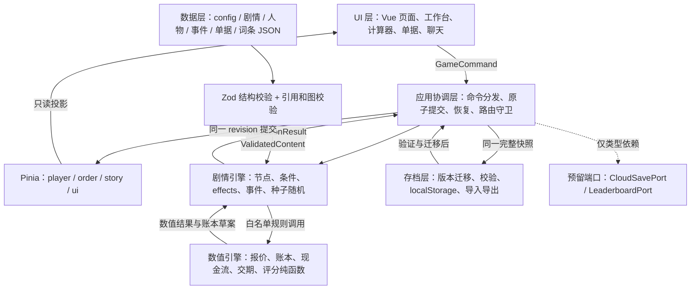

# 《出海第一单》项目开发规划

规划版本：1.3｜编制日期：2026-10-22｜更新日期：2026-10-23｜状态：七关、结局、事件、真实业务校正、平衡及七关视觉精修已验收；本轮完成三项 Bug 修复及输入、首屏和无效写盘优化，已通过本地回归，待用户验收。

**本文保留总体设计与阶段排程，不能将设计目标全部视为已实现。七关、业务校正、平衡、发布前体验、E05/本地指标、12 人验收准备、原生试玩包和七关视觉精修已逐阶段验收，网页版此前已获授权部署。本轮修复检查报告确认的三项 Bug，优化输入、首屏和无效写盘，保持 JSON 驱动和旧存档兼容，提供本地预览；不自动更新公开站点或原生包，不新增关卡、云存档、排行榜。专业签核与 12 人真实采集仍需独立完成。**

全文出现的金额、税率、费率、汇率和报价示例均属于「教学算例参数，可配置」，不代表实时行情、具体商品适用税率或银行报价。涉及这些数字的表格、算式和测试另行标注；JSON 通过配置引用及 `teachingOnly` 元数据表达同一约束。信誉、评分、概率、工时和数量不是货币参数。

## 1. 项目概述与范围确认

### 1.1 产品与教学闭环

《出海第一单》是一款 Vue 3 Web 单页外贸新手模拟器。目标玩家为零基础外贸新人、转行者和国贸学生。每局完成一笔传统 B2B 出口订单，正常完成局的有效游玩时间目标为 30–45 分钟；提前丢单或破产局不计入这一时长指标，另行统计。

统一体验顺序：**玩家决策 → 可见后果与数值变化 → 林姐复盘 → 操作纠错/继续推进**。首次决策前只展示事实、任务和一行术语释义；不预先展示答案、长篇教程或“正确选项”标签。每关至少一次复盘，每次不超过 120 个可见字符，目标阅读时间不超过 30 秒。即时反馈必须说明变化来源，例如“补检导致交期减少”，不得只有浮动数字。

2026-10-23 补充：首次操作引导允许三段可跳过的界面说明与按钮高亮，讲解“在哪里操作、怎样阅读后果”，不预先选择经营答案或填写计算结果。示范操作由玩家亲手提交，正常执行原有业务后果；后续使用情境提示，详见第 10.6 节。

### 1.2 范围基线

| 本期必做 | 最小完成定义 |
|---|---|
| 一条七关订单主线 | 选品→询盘→报价→谈判→签约备货→物流→单据收汇；客户、产品、付款方式在同一主线上产生参数与分支差异，不复制七条剧本 |
| 3 种产品、每种 3 家供应商、5 类客户 | 3 个产品记录、9 个供应商记录、5 个客户记录；导师单独建 NPC，不充当第六类客户 |
| 12 个随机事件、4 种结局 | 事件均可通过固定种子/测试夹具触达；每个事件至少两个有代价的选项；结局判定互斥且覆盖所有终止状态 |
| 五项经营指标 | 现金、累计利润、信誉、各客户信任、交期；现金与利润分别核算；付款等待与交货期限分别计时 |
| 三类核心交互 | 手填报价计算器、可点击/键盘定位的单据找错、至少三轮的聊天谈判 |
| 导师与学习反馈 | 每关复盘、24 张词条、五维评分、知识图谱、3 个关键决策回放 |
| 浏览器存档 | 自动/手动存档、读档、重开、JSON 导入导出、schema 迁移和损坏恢复 |
| 静态部署与响应式 | 无后端；桌面和手机浏览器可完整操作；静态站点刷新任一路由可恢复 |

明确不做且不分配工时：跨境电商平台后台模拟、多国家关税引擎、真实支付/汇率接口、3D、多人或联网对战、账号系统、移动端 App。云存档与排行榜本期仅定义端口类型，不接服务、不做入口、不开发模拟榜单。验货采用“清单勾选”，不制作照片识别玩法；保险凭证以合同数据摘要呈现，不扩为第六套找错模板。

### 1.3 必须先消解的需求冲突与推荐口径

1. **报价口径**：原题的“实际成本”已含国内费用时，FOB 不能再次加国内费用。第 6 章分开“退税后采购成本”和“含国内费用的 FOB 成本基数”。
2. **首单容错与淘汰**：首次致命失误进入一次可恢复的结算检查点；至少两次独立重大错误、已展示后果且纠错机会已处理后，才可确认破产。内部算错只触发学习反馈；交易终止必须来自对外业务行为和已知证据。结局按实际账本分类，不为了形成亏损虚构报价费或采购付款。
3. **五类客户与同行询盘**：同行是 `Inquiry.senderRole="competitor"` 的一次性发信人，不加入客户集合；每局第 2 关仍展示真实买家、同行、骗子各一封。真实买家从 A/B/C/E 抽取，教学首局推荐 C。
4. **四种结局的覆盖缺口**：“漂亮出海”要求利润为正且信誉达标；利润非负但信誉不足也进入“勉强保本”，附“小赚但信用不足”副标题，避免盈利低信誉无结局。
5. **交期与 OA**：签约起 30 个游戏日为“约定交货节点期限”，EXW 为工厂交付，FOB/CIF 为装运港装船；不是收汇期限。OA 的 60 个游戏日从合同约定的装运日计，应收款另设到期日，装船后不能继续扣交货逾期罚款。
6. **专业准确性**：海运集装箱教学算例保留 FOB/CIF，明确约定装船交付；另用词条提示现实在集装箱码头提前交承运人时应考虑 FCA/CPT/CIP。EXW 不自动赋予卖方退税资格；未取得并通过本剧情核验的出口证据不得确认退税。

以上推荐基线及第 12 章七项问题均已获得用户确认；后续业务修订以第 6.5 节为准，本轮工作范围为发布前体验与质量验收。

**范围验收 SCOPE-01**：需求追踪表能定位每个必做条目到文件、任务和测试；范围外条目无实现任务。产品负责人确认后冻结基线，修改数量或核心机制须更新本文与工时。

## 2. 系统架构图



技术栈固定：TypeScript strict、Vue 3 Composition API 与 `<script setup>`、Vite、Pinia、Tailwind CSS、pnpm、Vitest、Playwright、ESLint、Prettier。增加 Vue Router 管理页面，并以 `createWebHashHistory` 适配无需重写规则的纯静态托管；数值内部采用 decimal.js，属于计算工具依赖，不替换任何框架。安装版本在后续脚手架阶段核对兼容性并写入 lockfile，本轮不假设版本号。

选 **Zod**：用判别联合描述节点与 effect，通过同一 schema 解析 JSON 并推导 TypeScript 类型，降低手写类型和运行时规则漂移。编辑器用生成的 JSON Schema 提供提示，构建再执行跨文件语义校验；不使用实验性的反向转换功能。能力依据：[Zod 类型与校验说明](https://zod.dev/)、[JSON Schema 转换文档](https://zod.dev/json-schema)。

不引入 Ink/Twine 运行时：本项目主要复杂度在报价结构化输入、单据字段校验、财务原子事务、事件种子和存档恢复。外部叙事运行时仍需桥接这些状态，并产生第二份变量/存档语义。自研范围限制为有限节点图、白名单条件/效果、已注册纯函数，不开发通用脚本语言、可视化编辑器或任意代码执行器。

层间约束：组件不能导入账本写接口；stores 不能互相监听后自行扣钱。当前七关命令统一走 `useSliceGame.act` → `reduceSlice` → 持久化与完整快照投影；通用 `GameService.dispatch` 为后续接口预留。数值引擎不得导入 Vue、Pinia、DOM、localStorage 或系统时钟。Zod 校验失败的数据不能进入引擎。运行时错误进入可恢复错误面板，不偷偷改用默认答案。

**架构验收 ARCH-01**：依赖规则检查禁止 `src/components`、`src/views` 导入 `engine/economy` 写事务入口；同一输入/种子/版本产生同一快照；刷新不会重复执行 effect；模拟断电后只读到提交前或提交后的完整状态。

## 3. 目录结构

以下是下一轮之后逐步落地的目标树，**本轮不创建这些工程文件或空实现**。树中花括号表示列出的各个独立文件，`L01`–`L07` 对应七关，精确内容数量见第 7 章。

```text
项目根目录/
├─ PROJECT_PLAN.md                    # 本规划，本轮创建
├─ DIRECTORY_SKELETON.md              # 空目录骨架与创建时机说明，本轮创建
├─ package.json                       # 未来脚本入口与依赖
├─ pnpm-lock.yaml                     # 未来锁定依赖
├─ index.html                         # SPA 入口
├─ tsconfig{,.app,.node}.json          # strict 类型检查
├─ vite.config.ts                     # Vite、别名、构建与 Tailwind 接入
├─ vitest.config.ts                   # 核心公式覆盖率独立门槛
├─ playwright.config.ts               # 固定种子、桌面/手机测试
├─ eslint.config.js                   # 层依赖、组件禁公式等规则
├─ .prettierrc.json / .gitignore       # 格式、产物忽略
├─ .github/workflows/ci.yml           # 校验→类型→测试→构建→E2E
├─ docs/
│  ├─ content-authoring.md            # 顾问编辑 JSON、字段单位与例子
│  ├─ trade-review.md                 # 专业断言、来源、审校结论与版本
│  ├─ acceptance-matrix.md            # 需求→任务→测试→证据
│  └─ balance-report.md               # 策略、种子、分位数、试玩结果
├─ public/
│  └─ assets/{products,portraits,icons}/ # 静态展示资源；无剧情逻辑
├─ scripts/
│  ├─ validate-content.ts             # 全量结构、引用、图、计数校验
│  ├─ export-json-schema.ts           # 生成编辑器提示文件
│  ├─ simulate-balance.ts             # 无 DOM 的策略批量模拟
│  └─ audit-content-budget.ts         # 字数、复盘长度、必做数量统计
├─ schemas/generated/                # 未来生成的 JSON Schema，禁止手改
├─ src/
│  ├─ main.ts / App.vue               # 挂载与错误边界
│  ├─ router/{index,guards}.ts        # 路由及剧情访问守卫
│  ├─ styles/main.css                 # Tailwind、主题变量、移动断点
│  ├─ app/
│  │  ├─ GameService.ts               # 命令协调、提交、恢复
│  │  ├─ commands.ts                  # 用户命令判别联合
│  │  ├─ ContentRepository.ts         # 只返回已校验的数据
│  │  └─ ports/{SavePort,CloudSavePort,LeaderboardPort}.ts
│  ├─ domain/
│  │  ├─ types/{state,catalog,story,effects,events,documents,ending,save}.ts
│  │  └─ schemas/{common,config,catalog,story,effects,events,documents,save}.ts
│  ├─ engine/
│  │  ├─ story/{runner,conditions,effects,graph,events,rng,guards}.ts
│  │  ├─ economy/{decimal,quote,freight,ledger,cashflow,tax,deadline,score,ending}.ts
│  │  ├─ rules/{registry,contracts,procurement,logistics,collection,rescue}.ts
│  │  └─ puzzles/{quoteEvaluator,documentEvaluator,inspectionEvaluator}.ts
│  ├─ stores/{player,order,story,ui}.ts # 三业务 store + 纯界面 store
│  ├─ persistence/
│  │  ├─ localStorageRepository.ts    # 原子槽、容量错误、备份
│  │  ├─ codec.ts / integrity.ts      # JSON 编解码、摘要
│  │  ├─ migrations/{index,v1-to-v2}.ts # 逐版本纯迁移
│  │  └─ contentCompatibility.ts      # 内容版本与节点 id 映射
│  ├─ telemetry/{events,localSink,metrics}.ts # 本地匿名试玩记录
│  ├─ composables/{useGame,useGlossary,useSaveStatus}.ts
│  ├─ views/
│  │  ├─ HomeView.vue / DashboardView.vue
│  │  ├─ SupplierView.vue / MailView.vue / ChatView.vue
│  │  ├─ QuoteView.vue / ContractView.vue / InspectionView.vue
│  │  ├─ LogisticsView.vue / DocumentsView.vue / FinanceView.vue
│  │  └─ GlossaryView.vue / EndingView.vue / RecoveryView.vue
│  ├─ components/
│  │  ├─ layout/{WorkbenchShell,StatusBar,SideNav,MobileNav}.vue
│  │  ├─ shared/{MoneyValue,TermLink,ChoiceList,FeedbackPanel,MentorReview,
│  │  │          SaveIndicator,ErrorPanel,ConfirmDialog,FieldError}.vue
│  │  ├─ supplier/{ProductPicker,SupplierCompare,RiskBadge}.vue
│  │  ├─ chat/{MessageList,ReplyChoices,RoundProgress,PaymentCompare}.vue
│  │  ├─ quote/{CostInput,FormulaSteps,QuoteComparison,CashflowPreview}.vue
│  │  ├─ contract/{PIConfirm,InspectionChecklist}.vue
│  │  ├─ logistics/{ForwarderCompare,CutoffTimeline,DeclarationCheck}.vue
│  │  ├─ documents/{DocumentTabs,DocumentGrid,FieldMarker,DiscrepancyList}.vue
│  │  ├─ finance/{LedgerTable,ReceivableTimeline}.vue
│  │  └─ ending/{ScoreRadar,KnowledgeGraph,DecisionReplay}.vue
│  └─ content/
│     ├─ manifest.json                # 内容包版本、入口、资源映射
│     ├─ config/{economy,balance,scoring,runtime,system-effects,flags}.json
│     ├─ products.json / suppliers.json / customers.json / mentor.json
│     ├─ inquiries/templates.json     # 真假询盘与一次性同行发信人
│     ├─ logistics/forwarders.json    # 货代样本与日程配置
│     ├─ story/
│     │  ├─ L01/{main,branches,review}.json
│     │  ├─ L02/{main,branches,review}.json
│     │  ├─ L03/{main,branches,review}.json
│     │  ├─ L04/{main,branches,review}.json
│     │  ├─ L05/{main,branches,review}.json
│     │  ├─ L06/{main,branches,review}.json
│     │  └─ L07/{main,branches,review}.json
│     ├─ events/{e01,e02,e03,e04,e05,e06,e07,e08,e09,e10,e11,e12}.json
│     ├─ glossary/{g01…g24}.json       # 24 个独立词条文件
│     ├─ documents/{pi,invoice,packing-list,bill-of-lading,origin}.json
│     ├─ puzzles/{quote,inspection,declaration,documents}.json
│     ├─ endings/{excellent,breakeven,tuition,bankrupt}.json
│     └─ assessments/questions.json  # 前后测同知识点异数字题库
└─ tests/
   ├─ unit/{quote,freight,ledger,cashflow,tax,deadline,score,ending}.test.ts
   ├─ unit/{conditions,effects,events,rng,runner,migrations,puzzles}.test.ts
   ├─ content/{schema,references,reachability,authoring}.test.ts
   ├─ fixtures/{content,save-v1,save-v2,corrupt,seed-cases}/
   └─ e2e/{complete-run,lc-route,oa-route,rescue,save-recovery,mobile}.spec.ts
```

所有内容/配置文件通过 manifest 统一登记，加载器拒绝未登记引用；不依赖运行时任意拼接文件路径。五套单据模板与七关的 21 个节点文件分开计数。`work/` 是本轮核验材料目录，`outputs/` 是交付副本目录，不属于未来应用源码。

**目录验收 DIR-01**：本轮只有文档与核验材料；后续脚手架验收时，关键路径全部有职责对应，无真实云端实现、无关卡业务逻辑抢跑。

## 4. 核心数据模型

### 4.1 单位、版本与建模约束

金额持久化使用整数最小货币单位；类型中 `CnyFen` 表示人民币分，`UsdCent` 表示美分，须为安全整数。比率、汇率、未舍入单价使用十进制字符串 `DecimalText`。`currency`、计价单位和汇率方向随字段保存，禁止混加。财务 `cash`、`profit` 为账本投影缓存，导入时重算校验，不能由任意 `set` 覆盖。

以下为接口草案，类型别名与判别联合也是设计的一部分。实现时以 Zod schema 为单一事实源导出 `z.infer`，并保留这些公开类型名称；不维护两份可独立变更的结构。

```ts
type Id = string;
type DecimalText = string; // 有限十进制，禁止 NaN/Infinity/科学计数输入
type CnyFen = number; // 人民币分，安全整数
type UsdCent = number; // 美分，安全整数
type Stage = 1 | 2 | 3 | 4 | 5 | 6 | 7;
type Incoterm = 'EXW' | 'FOB' | 'CIF';
type PaymentMethod = 'TT' | 'LC_SIGHT' | 'OA_60';
type Scalar = string | number | boolean | null;
type EvaluatedValue = Scalar | Scalar[]; // 仅注册引用可返回数组供 in 比较
type TeachingNote = '教学算例参数，可配置';

interface Parameter<T> {
  value: T; // 标称值；抽样区间另由 balance 配置引用
  unit: string; // CNY/件、USD/箱、CNY/USD、比例、游戏日等
  teachingOnly: true;
  note: TeachingNote;
  reviewStatus: 'draft' | 'approved'; // 顾问确认状态
}
interface PlayerState {
  cashCnyFen: CnyFen; // 账本现金余额投影，允许负数用于终局判断
  cumulativeProfitCnyFen: CnyFen; // 已确认收入减费用，非现金净增加
  reputation: number; // 0–100，越界钳制
  trustByCustomer: Record<Id, number>; // 每客户独立 0–100
  learnedTermIds: Id[]; // 已看过反馈/复盘的词条
  masteredTermIds: Id[]; // 独立答对迁移题的词条
  criticalMistakeCount: number; // 独立重大错误，不重复计同一提交
  rescueUsed: boolean; // 本局一次重大错误恢复机会
}
interface Product {
  id: Id; name: string; description: string;
  unit: 'piece'; // 本期统一按件报价，包装箱数另存
  attributes: Record<string, string>; // 容量、材质、尺码等
  vatRateParam: Id; rebateRateParam: Id; // 配置 id，不写实时税率
  dimensionsCm: [number, number, number]; weightKg: DecimalText;
  unitsPerCarton: number; cartonCbm: DecimalText; // 由包装配置给出
  complianceProfileIds: Id[]; // 按产品×市场核验，不是通用“认证齐全”
  riskTags: Id[]; supplierIds: Id[]; // 恰好三个供应商
}
interface Supplier {
  id: Id; productId: Id; name: string;
  taxInclusiveUnitPriceParam: Id; moq: number; leadDays: number;
  depositRatioParam: Id; credentials: { id: Id; status: 'verified' | 'pending' | 'missing' }[];
  qualityRisk: DecimalText; delayRisk: DecimalText; // 配置概率
  riskEventIds: Id[]; negotiationStyle: string;
}
interface Customer {
  id: Id; name: string; identity: string; market: string;
  persona: 'precise' | 'bargainer' | 'novice' | 'fraud' | 'potential';
  tags: string[]; initialTrust: { min: number; max: number };
  bargainingStyle: string; exclusiveEventIds: Id[];
  preferredPayments: PaymentMethod[]; allowedPorts: Id[];
  dialogueBudget: { lines: number; chars: number };
}
interface Mentor {
  id: Id; name: string; age: number; experienceYears: number;
  tags: string[]; initialTrust: null; bargainingStyle: null;
  exclusiveEventIds: Id[]; dialogueBudget: { lines: number; chars: number };
}
interface Inquiry {
  id: Id; senderRole: 'buyer' | 'competitor' | 'fraud';
  customerId: Id | null; // 同行不创建客户
  subject: string; body: string; signalTags: Id[];
  requestedQuantity: number; replyNodeId: Id;
}
interface OrderState {
  id: Id; productId: Id | null; supplierId: Id | null; customerId: Id | null;
  quantity: number; incoterm: Incoterm | null; namedPlace: string | null;
  payment: PaymentMethod | null; quote: QuoteResult | null;
  contractUnitUsd: DecimalText | null; invoiceUsdCent: UsdCent | null;
  status: 'draft' | 'negotiating' | 'contracted' | 'producing' | 'shipped' | 'collected' | 'cancelled';
  signedDay: number | null; deliveryDueDay: number | null;
  deliveryCompletedDay: number | null; collectionDueDay: number | null;
  remainingDeliveryDays: number | null; // 未签约显示“待签约”，不倒扣
  overdueDaysCharged: number; taxEligibility: 'pending' | 'eligible' | 'ineligible';
  flags: Record<Id, Scalar>; // 键必须注册在 flags.json
}
interface StoryProgress {
  stage: Stage; nodeId: Id; visitIndex: number;
  seed: string; rngVersion: number;
  rngState: Record<'parameters' | 'events' | 'documents', number[]>;
  drawCount: number; // 三条随机流分别保存状态，总抽样次数用于审计
  sampledParameters: Record<Id, Scalar>; // 开局实例化结果，读档不重抽
  completedNodeIds: Id[]; appliedCommandIds: Id[]; triggeredEventIds: Id[];
  pendingEvent: { eventId: Id; returnNodeId: Id } | null;
  puzzleDrafts: Record<Id, Record<string, Scalar>>;
  pendingFeedback: { sourceId: Id; reviewNodeId: Id } | null;
  decisionLog: DecisionRecord[]; // 含前后状态摘要与评分证据
}
type Account = 'cash' | 'capital' | 'sales' | 'expense' | 'inventory'
  | 'supplierAdvance' | 'customerAdvance' | 'receivable' | 'payable' | 'taxReceivable';
interface JournalEntry {
  id: Id; commandId: Id; sourceNodeId: Id; gameDay: number;
  description: string;
  postings: { account: Account; side: 'debit' | 'credit'; amountCnyFen: CnyFen }[];
  foreignMoney?: { currency: 'USD'; cents: UsdCent; fxCnyPerUsd: DecimalText };
  // 每笔借贷平衡；记录外币原额与采用汇率，避免收汇时重复确认收入
}
interface DecisionRecord {
  id: Id; nodeId: Id; choiceId: Id; stage: Stage; sequence: number;
  deltas: { cashCnyFen: CnyFen; profitCnyFen: CnyFen; reputation: number; trust: number; days: number };
  evidence: { rubricId: Id; earned: number; possible: number }[];
  consequenceText: string; counterfactualReviewId: Id | null;
}
interface GameSnapshot {
  revision: number; runId: Id; gameDay: number;
  player: PlayerState; order: OrderState; story: StoryProgress;
  journal: JournalEntry[]; scheduled: ScheduledAction[];
  rescueCheckpoint: { snapshotRevision: number; checkpointId: Id } | null;
}
interface ScheduledAction {
  id: Id; dueGameDay: number; effectListId: Id; status: 'pending' | 'applied';
}
```

### 4.2 剧情、条件、效果与小游戏

```ts
type ValueExpr =
  | { kind: 'literal'; value: Scalar }
  | { kind: 'ref'; scope: 'state' | 'config' | 'input' | 'result'; path: string }
  | { kind: 'randomInt'; min: number; max: number; drawKey: Id }
  | { kind: 'randomDecimal'; min: DecimalText; max: DecimalText; step: DecimalText; drawKey: Id };
type Condition =
  | { op: 'all' | 'any'; conditions: Condition[] }
  | { op: 'not'; condition: Condition }
  | { op: 'eq' | 'ne' | 'gt' | 'gte' | 'lt' | 'lte' | 'in'; left: ValueExpr; right: ValueExpr }
  | { op: 'exists'; value: ValueExpr };
type Effect =
  | { op: 'adjust'; target: string; value: ValueExpr; clamp?: { min: number; max: number } }
  | { op: 'set'; target: string; value: ValueExpr }
  | { op: 'advanceDays'; value: ValueExpr; reason: Id }
  | { op: 'rule'; ruleId: Id; args: Record<string, ValueExpr> }
  | { op: 'unlockTerm'; termId: Id }
  | { op: 'recordEvidence'; rubricId: Id; earned: number }
  | { op: 'if'; when: Condition; then: Effect[]; else: Effect[] };
interface Choice {
  id: Id; label: string; when: Condition; disabledReason: string | null;
  effects: Effect[]; feedback: string; nextNodeId: Id;
}
type NodeType = 'dialogue' | 'choice' | 'calc' | 'document' | 'inspection'
  | 'review' | 'checkpoint' | 'settlement';
interface NodeBase {
  id: Id; stage: Stage; type: NodeType; title: string;
  entryWhen: Condition; onEnterEffects: Effect[]; // 按访问实例幂等
  tags: Id[]; teachingOnly: true;
}
interface ChoiceNode extends NodeBase {
  type: 'choice'; speakerId: Id; prompt: string; choices: Choice[];
}
interface CalcNode extends NodeBase {
  type: 'calc'; puzzleId: Id; evaluatorId: 'quote.v1';
  results: { when: Condition; effects: Effect[]; feedback: string; nextNodeId: Id }[];
  // 首个匹配结果执行，最后一个必须为恒真兜底
}
interface TextNode extends NodeBase {
  type: 'dialogue' | 'review'; speakerId: Id; text: string; nextNodeId: Id;
}
interface PuzzleNode extends NodeBase {
  type: 'document' | 'inspection'; puzzleId: Id; evaluatorId: Id;
  results: CalcNode['results'];
}
interface TerminalNode extends NodeBase {
  type: 'settlement'; resultMode: 'completed' | 'lost_order' | 'bankrupt';
}
interface CheckpointNode extends NodeBase {
  type: 'checkpoint'; checkpointId: Id; nextNodeId: Id;
}
type StoryNode = ChoiceNode | CalcNode | TextNode | PuzzleNode | TerminalNode | CheckpointNode;
interface GameEvent {
  id: Id; title: string; stages: Stage[];
  window: 'beforeDecision' | 'afterStage' | 'beforeCollection';
  weight: number; when: Condition; oncePerRun: true;
  mutexGroup: Id | null; priority: number; choiceNodeId: Id;
  minChoices: 2; maxExtraDays: number; reviewNodeId: Id;
}
interface DocumentPuzzle {
  id: Id; templateIds: Id[]; source: 'confirmedOrder';
  faults: { id: Id; documentId: Id; fieldPath: string; mutation: Scalar;
    expectedFrom: string; explanation: string; severity: 'major' | 'minor'; termIds: Id[] }[];
  requiredFaultCount: number; maxAttemptsBeforeGuidance: number;
  comparisonRules: { id: Id; fieldPaths: string[]; mode: 'exact' | 'number' | 'semantic' }[];
  // 答案存于引擎；UI 只接收展示字段和当前已揭示反馈
}
interface QuoteInput {
  taxInclusiveUnitCny: DecimalText; quantity: number;
  vatRate: DecimalText; rebateRate: DecimalText; rebateEligible: boolean;
  domesticTotalCny: DecimalText; fxCnyPerUsd: DecimalText;
  costMarkupRate: DecimalText; oceanTotalUsd: DecimalText;
  insuranceCoverageFactor: DecimalText; insuranceRate: DecimalText;
}
interface QuoteResult {
  rebateUnitCny: DecimalText; netPurchaseUnitCny: DecimalText;
  domesticUnitCny: DecimalText; fobCostUnitCny: DecimalText;
  fobUnitUsdRaw: DecimalText; cifUnitUsdRaw: DecimalText;
  fobUnitUsdQuoted: DecimalText; cifUnitUsdQuoted: DecimalText;
  insuranceTotalUsd: DecimalText; // 以 CIF 两位报价×数量重算；签约后再按实际合同额确认
  steps: { formulaId: Id; inputs: Record<string, DecimalText>; output: DecimalText }[];
}
interface EndingResult {
  kind: 'excellent' | 'breakeven' | 'tuition' | 'bankrupt';
  completion: 'completed' | 'lost_order' | 'bankrupt'; subtitle: string;
  profitCnyFen: CnyFen; finalCashCnyFen: CnyFen;
  scores: { profit: number; risk: number; professionalism: number; relationship: number; compliance: number };
  learnedTermIds: Id[]; masteredTermIds: Id[]; replayDecisionIds: Id[];
  repeatIntent: { unlocked: boolean; customerId: Id | null };
  scoreEvidenceIds: Id[]; unsettledItems: Id[];
}
```

`ref.path` 虽为字符串，实际由 schema 与注册表限制到白名单，不是任意对象访问。`set` 只写合同枚举、已注册 flags、选择 id 和草稿；`adjust` 只允许信誉与指定客户信任。现金、利润、交期、应收应付一律由领域 `rule` 或 `advanceDays` 生成的 effects 改变。`result` 为本次可信纯函数输出，不接受导入存档或 UI 提供的“correct=true”。

### 4.3 应用边界接口

```ts
interface GameService {
  dispatch(command: GameCommand): Promise<DispatchResult>;
  getSnapshot(): Readonly<GameSnapshot>;
  restore(save: unknown): Promise<RestoreResult>;
}
type GameCommand = {
  commandId: Id; expectedRevision: number; nodeId: Id;
} & (
  | { type: 'choose'; choiceId: Id }
  | { type: 'submitQuote'; answers: Record<string, DecimalText> }
  | { type: 'submitPuzzle'; selectedFieldIds: Id[]; corrections: Record<string, Scalar> }
  | { type: 'continue' }
  | { type: 'useRescue' }
);
type DispatchResult =
  | { ok: true; revision: number; feedbackId: Id; saveStatus: 'saved' | 'memoryOnly' }
  | { ok: false; code: 'STALE_REVISION' | 'INVALID_INPUT' | 'CONTENT_ERROR'; message: string };
type RestoreResult = { ok: true; migratedFrom: number | null }
  | { ok: false; code: 'CORRUPT' | 'FUTURE_VERSION' | 'CONTENT_MISMATCH'; recoverable: boolean };
interface TransitionResult {
  snapshot: GameSnapshot; journalAdded: JournalEntry[]; feedbackId: Id;
}
interface SavePort {
  load(slotId: Id): Promise<unknown | null>;
  save(slotId: Id, envelope: SaveEnvelope): Promise<void>;
  remove(slotId: Id): Promise<void>;
}
interface CloudSavePort { // 仅声明；本期不实例化
  pull(runId: Id): Promise<unknown | null>;
  push(save: SaveEnvelope, expectedRemoteRevision: number | null): Promise<{ revision: number }>;
}
interface LeaderboardPort { // 仅声明；本地成绩不具备可信防作弊能力
  submit(result: EndingResult): Promise<void>;
  list(limit: number): Promise<readonly { displayName: string; score: number }[]>;
}
```

**数据验收 MODEL-01**：所有内容、存档与命令有 schema；单位错配、负数量、未知 id、未知路径、非法枚举、额外字段全部报出文件与 JSON Pointer。公开类型可由 schema 推导，不出现 `any` 绕过校验。

## 5. 剧情引擎设计

### 5.1 执行时序与节点职责

一次命令执行：校验 revision/节点/选择 → 获取不可变快照 → 校验条件 → 只在授权抽样点消耗 PRNG → 调用纯函数评估输入 → 顺序展开 effects → 生成账本与派生指标 → 处理交期和到期动作 → 检查首次致命错误恢复机制 → 生成反馈与评分证据 → 统一提交三个业务 store → 保存完整快照 → 展示后果 → 允许进入 review 节点。

| 节点 | 交互和出口 | 通过标准 |
|---|---|---|
| dialogue | 一条/一组短对话，继续按钮 | 不扣隐性时间；有唯一下一节点 |
| choice | 至少两个选项，可含前置条件 | 至少一个可用选项；禁止靠文案猜隐藏条件 |
| calc | 报价字段提交给 quoteEvaluator | 按步骤识别错误，成功/错误均有出口 |
| document | 选择错误字段并修正 | 记录误报、漏报、已纠正项；不按“点了三次”判胜 |
| inspection | 清单证据核对 | 至少一次风险判断与一次处置选择 |
| review | 后果之后的林姐短复盘 | ≤120 字；词条点亮；可立即继续 |
| checkpoint | 无可见业务决策的恢复快照边界 | 不重复入账；自动跳转链有上限 |
| settlement | 冻结订单并生成结局 | 只执行一次；结局页不继续触发事件 |

`evaluateCondition(condition, context): boolean`、`applyEffects(effects, context): TransitionResult`、`advanceNode(snapshot, command, content): TransitionResult`、`drawEvent(pool, snapshot, rng): EventSelection` 均无 DOM。单次自动节点链最多 32 跳；条件/effects 嵌套最多 8 层；单次最多 64 个展开效果；超限作为内容错误恢复到上一提交点。

### 5.2 DSL 完整规范

| 能力 | 规则 |
|---|---|
| 常量和引用 | `literal` 必须具有字段要求的类型；`ref` 的 scope/path 必须登记；数组成员测试的右侧使用返回标量数组的注册引用，求值返回 `EvaluatedValue`，只读，不允许对象运算 |
| 条件 | `all`/`any`/`not`；`eq/ne/gt/gte/lt/lte/in/exists`；数值先按字段单位解析为 Decimal，禁隐式字符串转数值；空 all=true，空 any=false |
| 条件中的随机 | 禁止。事件筛选/渲染同一条件时不得消耗随机数 |
| 范围随机 | `randomInt` 闭区间整数；`randomDecimal` 按 step 离散均匀取样，端点对齐；min≤max、step>0；只能在开局实例化或 effect 中使用 |
| 随机复现 | 采用带版本的 xoshiro128**，每流保存四个 uint32；根 seed 经固定哈希分出参数/事件/单据扰动三个流；`drawKey+节点访问序号+效果序号` 唯一；抽样值与状态一起保存；刷新、重试和返回上一页不重抽；不得调用 Math.random |
| 加减与钳制 | `adjust` 可加负数，先加后 clamp；信誉/信任强制处于 0–100；内容可收紧不能放宽边界；现金禁止 clamp 到非负以掩盖破产 |
| 天数 | `advanceDays` 仅接受非负整数；退回纠错不倒退世界时间，恢复交易时按恢复规则还原快照，再收取已说明的纠错时间 |
| 领域规则 | `ruleId` 映射白名单处理器，如 `quote.accept`、`ledger.sampleExpense`、`contract.sign`、`procurement.payDeposit`、`collection.receive`；args 独立 schema；禁止 JS 表达式、eval、脚本 URL |
| 条件效果 | `if` 只执行一侧；逐个 effect 读取前一个 effect 的临时结果；整个列表验证通过后一次提交，任何异常全部回滚 |
| 标记与学习 | `set` 的字段由 flags 表规定类型与生命周期；词条 unlock 去重；评分证据按 rubric+机会 id 去重，不靠刷节点加分；内容请求的 earned 还受尝试次数上限约束，辅导后即使 JSON 请求满分也最多记 1 分 |
| 副作用限制 | 金额、利润、天数变化必须能追溯至节点/事件/系统节点的 effects；UI 按钮不得直接改 store；系统逾期/到期收款规则通过 `system-effects.json` 注册的 effect 列表展开 |

原需求 `{cash: -…, reputation: +…, trust:client_a: -…, days: -…}` 仅作为概念简写，不作为生产格式。生产拆成财务规则、信誉 adjust、客户信任 adjust 与 advanceDays，确保账本和现金不被绕过。配置 id 和路径使用完整前缀，例如 `economy.quote.base.costMarkupRate.value`；不得把百分数展示字符串直接参与计算。

共享客户节点通过已注册的 `customer.adjustActiveTrust` 规则从 `order.customerId` 解析目标，禁止在路径里执行字符串模板或任意插值。`unlockTerm` 使词条可见；`learning.recordViewed` 由反馈/复盘继续命令的 effects 记录已接触，迁移题的评估 effects 记录已掌握，避免只加载节点就算读过。

### 5.3 完整 JSON 节点示例一：谈判第二轮

这是节点文件中的完整节点对象；所有数字为信任/评分/天数，不含内嵌货币费率。对外价格与付款比例来自配置。节点引用的 `client_c`、下一节点、rule 和词条须由 manifest 所属内容包提供。

```json
{
  "id": "L04.payment.round2",
  "stage": 4,
  "type": "choice",
  "title": "谈付款：容易成交，也要接得住",
  "entryWhen": {"op": "eq", "left": {"kind": "ref", "scope": "state", "path": "order.customerId"}, "right": {"kind": "literal", "value": "client_c"}},
  "onEnterEffects": [],
  "tags": ["payment", "cashflow"],
  "teachingOnly": true,
  "speakerId": "client_c",
  "prompt": "我第一次进口，能不能收到货后再付？或者先付一部分？",
  "choices": [
    {
      "id": "tt_with_explanation",
      "label": "按定金和尾款分期，说明验货资料与提单副本的安排",
      "when": {"op": "all", "conditions": []},
      "disabledReason": null,
      "effects": [
        {"op": "set", "target": "order.payment", "value": {"kind": "literal", "value": "TT"}},
        {"op": "adjust", "target": "player.trustByCustomer.client_c", "value": {"kind": "literal", "value": 4}, "clamp": {"min": 0, "max": 100}},
        {"op": "recordEvidence", "rubricId": "risk.payment_choice", "earned": 2},
        {"op": "unlockTerm", "termId": "g11_tt"}
      ],
      "feedback": "客户接受分期原则；她还要看交货安排。信任上升，订单尚未签约，也尚未收款。",
      "nextNodeId": "L04.payment.tt_review"
    },
    {
      "id": "oa_accept",
      "label": "接受账期，再查看垫资缺口和最晚收款日",
      "when": {"op": "all", "conditions": []},
      "disabledReason": null,
      "effects": [
        {"op": "set", "target": "order.payment", "value": {"kind": "literal", "value": "OA_60"}},
        {"op": "adjust", "target": "player.trustByCustomer.client_c", "value": {"kind": "literal", "value": 6}, "clamp": {"min": 0, "max": 100}},
        {"op": "rule", "ruleId": "cashflow.preview", "args": {"payment": {"kind": "ref", "scope": "state", "path": "order.payment"}}},
        {"op": "recordEvidence", "rubricId": "risk.payment_choice", "earned": 0},
        {"op": "unlockTerm", "termId": "g14_oa"}
      ],
      "feedback": "客户更愿意成交，但预付款不会到账；资金时间轴显示需要先垫付采购和运输。",
      "nextNodeId": "L04.payment.oa_review"
    },
    {
      "id": "lc_propose",
      "label": "提出即期信用证，并核验开证行和可履行条款",
      "when": {"op": "all", "conditions": []},
      "disabledReason": null,
      "effects": [
        {"op": "set", "target": "order.payment", "value": {"kind": "literal", "value": "LC_SIGHT"}},
        {"op": "advanceDays", "value": {"kind": "literal", "value": 1}, "reason": "bank_precheck"},
        {"op": "recordEvidence", "rubricId": "risk.payment_choice", "earned": 1},
        {"op": "unlockTerm", "termId": "g12_lc"}
      ],
      "feedback": "核验多花了一天，客户担心办理成本；接下来需要把银行条件谈清楚。",
      "nextNodeId": "L04.payment.lc_review"
    }
  ]
}
```

补充注册要求：三个 review 节点都指向 `L04.terms.round3`；报价/术语第一轮先行存在；下一轮不能因为客户不偏好某方式而无提示卡死。`cashflow.preview` 只写预估结果 flags，不改变现金。评分反映此情境的权衡，不能把所有 L/C 永久判定为最优。

### 5.4 完整 JSON 节点示例二：报价提交

`puzzle_quote_main` 规定手填字段、单位、配置引用和容差。计算正确性来自数值引擎；错误时先显示报价后果，再进入导师纠错，不能因第一次算错直接判丢单。

```json
{
  "id": "L03.quote.submit",
  "stage": 3,
  "type": "calc",
  "title": "把这笔报价算明白",
  "entryWhen": {"op": "exists", "value": {"kind": "ref", "scope": "state", "path": "order.supplierId"}},
  "onEnterEffects": [],
  "tags": ["quote", "rebate", "markup"],
  "teachingOnly": true,
  "puzzleId": "puzzle_quote_main",
  "evaluatorId": "quote.v1",
  "results": [
    {
      "when": {"op": "eq", "left": {"kind": "ref", "scope": "result", "path": "quote.correct"}, "right": {"kind": "literal", "value": true}},
      "effects": [
        {"op": "rule", "ruleId": "quote.accept", "args": {"quoteResult": {"kind": "ref", "scope": "result", "path": "quote.resultId"}}},
        {"op": "adjust", "target": "player.reputation", "value": {"kind": "literal", "value": 3}, "clamp": {"min": 0, "max": 100}},
        {"op": "recordEvidence", "rubricId": "professional.quote", "earned": 2},
        {"op": "unlockTerm", "termId": "g05_rebate"},
        {"op": "unlockTerm", "termId": "g06_markup_margin"}
      ],
      "feedback": "成本、退税和利润口径一致；报价草案已生成，仍需谈判确认合同价格。",
      "nextNodeId": "L03.quote.success_review"
    },
    {
      "when": {"op": "eq", "left": {"kind": "ref", "scope": "result", "path": "quote.errorCode"}, "right": {"kind": "literal", "value": "REBATE_OMITTED"}},
      "effects": [
        {"op": "rule", "ruleId": "learning.quoteMistake", "args": {"code": {"kind": "literal", "value": "REBATE_OMITTED"}}},
        {"op": "adjust", "target": "player.reputation", "value": {"kind": "literal", "value": -2}, "clamp": {"min": 0, "max": 100}},
        {"op": "advanceDays", "value": {"kind": "literal", "value": 1}, "reason": "quote_rework"}
      ],
      "feedback": "报价高于同条件核算结果，买家暂缓回复；先核对可退税金额，还有一次引导重算机会。",
      "nextNodeId": "L03.quote.rebate_review"
    },
    {
      "when": {"op": "eq", "left": {"kind": "ref", "scope": "result", "path": "quote.errorCode"}, "right": {"kind": "literal", "value": "MARGIN_AS_MARKUP"}},
      "effects": [
        {"op": "rule", "ruleId": "learning.quoteMistake", "args": {"code": {"kind": "literal", "value": "MARGIN_AS_MARKUP"}}},
        {"op": "adjust", "target": "player.reputation", "value": {"kind": "literal", "value": -2}, "clamp": {"min": 0, "max": 100}},
        {"op": "advanceDays", "value": {"kind": "literal", "value": 1}, "reason": "quote_rework"}
      ],
      "feedback": "你把任务要求的成本加成率当成了销售毛利率；两者分母不同，当前报价偏离目标。",
      "nextNodeId": "L03.quote.markup_review"
    },
    {
      "when": {"op": "all", "conditions": []},
      "effects": [
        {"op": "rule", "ruleId": "learning.quoteMistake", "args": {"code": {"kind": "literal", "value": "OTHER_QUOTE_ERROR"}}}
      ],
      "feedback": "至少一项字段的单位或计算结果不一致；查看第一处差异，再提交修正。",
      "nextNodeId": "L03.quote.generic_review"
    }
  ]
}
```

例中 `quote.resultId` 仅能指向本次评估缓存，不是接受任意外部结果对象。所有错误分支先到复盘；`learning.quoteMistake` 按首次/引导重算/重复故意错误记录尝试，复盘后的路由由统一 guard 选择重算或“失去订单”的结算节点，不能无限扣分或刷信誉。正确后用新的数字做一题简短迁移检查，区分看答案与掌握。

### 5.5 构建与运行时校验

构建顺序：所有 JSON 结构 → 唯一 id → 人物/产品/事件/词条/规则/参数引用 → 节点边和入口 → 从各入口到结局的可达性 → 强连通分量必须有合法出口与循环预算 → 每种条件环境至少有一个选择 → 文案预算、数量与审校门禁。复杂经济状态采用有限测试状态集和批量模拟，不能声称静态图检查证明所有状态可达。

报错格式示例：`L04/main.json#/nodes/2/choices/1/nextNodeId: 未找到节点 L04.payment.oa_review`。任何不存在的节点、客户或配置引用必须让 `pnpm build` 前置校验退出非零。运行时 `safeParse` 失败时停止该事务，显示内容版本、错误 id、恢复入口，保留上一有效存档。不得吞错后给玩家免费通关。

**引擎验收 ENGINE-01**：两示例节点可被 schema 解析；完整示例包补齐所有引用后可运行；缺一个引用构建失败；同命令重放零重复入账；三次刷新不改变随机事件；首次错误→后果→复盘→修正可用；条件错误不产生半笔资金变动。

## 6. 数值引擎设计

### 6.1 配置表与可调边界

配置分为 `economy.json`（金额/税费/汇率）、`balance.json`（抽样与风险）、`scoring.json`（评分与结局）、`runtime.json`（容量/版本/节奏）、`system-effects.json`（系统触发效果）、`flags.json`（字段注册）。金额、税率、费率、汇率每一叶子都使用 `Parameter<T>`，保留单位、教学标签与审校状态。以下是初始调参基线，不是最终平衡结论。

| 配置路径 | 初始值与单位 | 边界/说明 |
|---|---|---|
| economy.initial.cash | ¥100,000（教学算例参数，可配置） | 开局借现金、贷资本；不是订单收入 |
| balance.initial.reputation | 60/100 | 初始客户信任按人设在 40–60 抽样 |
| balance.deadline.deliveryDays | 30 个游戏日 | 签约才启动，到约定交付节点停止 |
| economy.quote.base.taxInclusiveUnitCny | ¥28.00/件（教学算例参数，可配置） | 黄金算例；其他产品由供应商配置覆盖 |
| economy.quote.base.vatRate | 13%（教学算例参数，可配置） | 不是对保温杯实际税率的判断 |
| economy.quote.base.rebateRate | 9%（教学算例参数，可配置） | 先检查退税条件；不可默认所有供应商均可退 |
| balance.quote.base.quantity | 5,000 件 | 只作黄金算例；首局 C 按产品数量池抽取并满足 MOQ，见第 7.2 节 |
| economy.quote.base.domesticUnitCny | ¥0.70/件（教学算例参数，可配置） | 黄金算例国内总费用为 ¥3,500（教学算例参数，可配置），只加一次 |
| economy.quote.base.fxCnyPerUsd | 7.20 CNY/USD（教学算例参数，可配置） | 显示“每美元兑换多少人民币”，人民币转美元用除法 |
| economy.quote.base.costMarkupRate | 11%（教学算例参数，可配置） | 对成本加成，UI 不含糊称“利润率” |
| economy.quote.base.oceanTotalUsd | $2,850/20GP（教学算例参数，可配置） | 黄金算例假设单柜可装满订单；真实箱规不是本期实时数据 |
| economy.quote.base.insuranceCoverageFactor | 110%（教学算例参数，可配置） | 默认教学基线遵循 CIF 最低投保金额要求；可向上调，不在“符合规则”模式向下调 |
| economy.quote.base.insuranceRate | 0.6%（教学算例参数，可配置） | 为复现约 $4.68/件（教学算例参数，可配置）所选，不是市场保险费率 |
| economy.payment.tt.depositRatio / balanceRatio | 30% / 70%（教学算例参数，可配置） | 定金到账后采购；尾款触发点是提单副本符合约定且客户付款，不代表银行担保 |
| economy.procurement.depositRatio / balanceRatio | 30% / 70%（教学算例参数，可配置） | 各供应商可不同，备货前/验货后付；总和必须完整 |
| balance.payment.oa.days | 60 个游戏日 | 独立应收到期日；可快进，不要求现实等待 |
| economy.bank.tt.fixedFee | ¥300/订单（教学算例参数，可配置） | 固定费；银行超预期事件仅加差额，不重复原费用 |
| economy.preparation.sampleFee | ¥200/首单（教学算例参数，可配置） | L01 明示打样/资料核验服务，玩家确认后入账；保证早期丢单有真实已发生准备成本 |
| economy.bank.lc.fixedFee / rate | ¥800 + 合同额的 0.4%（教学算例参数，可配置） | 费用承担方写进合同；核验与改单另列配置 |
| economy.deadline.penaltyPerDay | ¥200/逾期游戏日（教学算例参数，可配置） | 游戏合同延误费用，非 Incoterms 自动罚则 |
| balance.deadline.reputationLossPerDay | 2 点/日 | 只对新增逾期日扣一次 |
| balance.inquiry.lowReputationThreshold | 30 | 严格小于阈值才生效 |
| balance.inquiry.followupBase / reduced | 后续跟进机会 2 次 / 1 次 | 表示后续询盘机会减半；第 2 关初始三封分类题不删除 |
| balance.rescue.limit | 1 次/局 | 报价逐步辅导单独计尝试，不占用财务致命恢复次数 |
| balance.events.perStageCap / perRunCap | 通常每关 1 个、每局 3 个 | L/C 必选软条款计入 3 个上限；不是一局强塞 12 个 |
| balance.events.drawProbability | 0.35 | 合法窗口先过发生概率，再按权重抽取；软条款在 L/C 首次审证窗口强制 |
| balance.events.fx.relativeChange | ±1.5%（教学算例参数，可配置） | 乘当前阶段基准汇率，同阶段不叠加重抽 |
| balance.events.ocean.relativeIncrease | 20%（教学算例参数，可配置） | 未锁定运价且由卖方承担时改变本方支出 |
| balance.events.randomLossCap | 开局现金的 5%（教学算例参数，可配置） | 纯外生事件单次损失上限；不保护主动承诺的无限账期/低价大单 |
| balance.ending.excellentReputation | 80 | 利润须同时为正 |
| economy.scoring.targetReturnOnCost | 10%（教学算例参数，可配置） | 利润评分标尺，不是保证收益 |
| runtime.rounding / precision | HALF_UP / 28 位有效数字 | 账本入分，UI 单价两位；未舍入中间值保留 |

金额与费率的可配置不等于可以绕过规则：数量为正整数；汇率为正；保险分母为正；退税资格不可由随机费率替代；佣金/运费不得负数；输入数值上限由配置 schema 和安全整数限制共同检查。

### 6.2 全部核心公式与取整策略

记 `P` 为含税采购单价（人民币），`Q` 为件数，`v` 为增值税率，`r` 为退税率，`D` 为本方应承担的国内费用总额，`E` 为 CNY/USD，`m` 为成本加成率，`F` 为本方海运总价（美元），`a` 为保险加成系数，`i` 为保费率。资格不成立时 `R=0`。

| 编号/文件 | 公式 | 边界与确认时点 |
|---|---|---|
| F01 `tax.ts` | 每件可预计退税 `R=P/(1+v)×r` | 仅外贸企业采购含税价教学模型；依有效凭证、出口及收汇条件核验，不覆盖生产企业免抵退、HS 判定等 |
| F02 `quote.ts` | 退税后采购成本 `C=P-R`；国内分摊 `d=D/Q`；FOB 基数 `B=C+d` | `D` 不得已含在 `C`；税款预计应收不是立即可用现金 |
| F03 `quote.ts` | FOB 未舍入单价 `FOBraw=B/E×(1+m)` | 利润率口径固定为成本加成率；币种和运费边界显式 |
| F04 `quote.ts` | 销售毛利率 `g=(S-Cost)/S`；成本加成率 `m=(S-Cost)/Cost`；`g=m/(1+m)`，`m=g/(1-g)` | 两种口径都有效；把题目指定的一种误当另一种才判错 |
| F05 `freight.ts` | 所需柜数 `N=ceil(max(总CBM/可用柜容, 总毛重/可用载重))`；`F=N×柜价+本方承担附加费`；单件运费 `f=F/Q` | 瑜伽服突出体积限制；装箱率/尺寸来自教学包装配置；本期只做整柜估算，不增加拼箱计费引擎 |
| F06 `quote.ts` | `CIFraw=(FOBraw+f)/(1-a×i)`；每件保险 `CIFraw×a×i` | 解析消除循环依赖；要求 `0≤a×i<1`；保费只计一次 |
| F07 `quote.ts` | 合同单价 `S=round2(raw)`；合同总额 `Invoice=round2(S×Q)`；实际预计保费 `round2(Invoice×a×i)` | 黄金算例 CIF 的 FOB 输入是未舍入内部基准；若合同明写已舍入 FOB 再加保费，须作为另一模式显式记录 |
| F08 `quote.ts` | EXW 基数为 `P-合资格R+本方工厂交付费用分摊`，换汇后加成 | 不加本不由卖方承担的报关/港杂；未能证明退税资格时用无退税成本报价 |
| F09 `cashflow.ts` | 客户定金 `round2(Invoice×定金比例)`；尾款 `Invoice-定金`；供应商尾款亦由总额减定金 | 从总额减已收/已付防止四舍五入差额；付款比例总和校验 |
| F10 `ledger.ts` | 现金=现金科目借方−贷方；累计利润=收入贷方−借方−费用借方+贷方 | 开局资本不算收入；采购预付款不立即全算费用；同一笔 effect 对应唯一 journal id |
| F11 `ledger.ts` | 出货时确认收入和对应销售成本；预计合资格退税借税款应收、贷费用冲减；收退税借现金、贷税款应收 | 先作为预测展示，满足教学核验条件后才确认；订单结束前核验、收款或转为不可收回费用 |
| F12 `collection.ts` | 收汇现金=外币实收×到账汇率−手续费；汇兑损益=实际折人民币−冲销应收账面人民币 | 只把差额进损益，不能再把整笔尾款当新收入 |
| F13 `deadline.ts` | 剩余交期=`dueDay-currentDay`；累计逾期=`max(0,min(currentDay,deliveredDay)-dueDay)` | 未交付时 min 取 currentDay；每次仅扣累计逾期减已扣天数；交付后冻结 |
| F14 `deadline.ts` | 新增罚款=新增逾期天数×每日费用；新增信誉损失=新增逾期天数×每日信誉扣点 | 罚款通过合同费用入账，同时减少利润和现金，不能再独立减利润一次 |
| F15 `cashflow.ts` | 未来最小现金=`min(当前现金+按日期排序的收支前缀和)` | 同日先处理合同要求的付款，再处理尚无到账确认的收款；预览分“已确定”与“预计” |
| F16 `cashflow.ts` | OA 到期=`合同装运日+账期天数`；持有成本=`占用本金×年化配置费率×天数/计息年天数`（若配置启用） | 本期默认关闭融资产品，只体现资金占用与已明确的管理费；不把机会成本自动扣成现金 |
| F17 `score.ts` | `clamp(x,lo,hi)=min(hi,max(lo,x))`；概率分布见事件章节 | 现金不作非负钳制；信誉/信任/评分才钳制 |
| F18 `ending.ts` | 按第 6.6 节优先级匹配唯一结局 | 终止后禁止追加常规事件，未结项目须披露 |

所有货币运算使用 Decimal，最终进入账本时转整数分并检查安全整数。展示中间单价可保留四位或六位，底层不拿展示值继续计算。`toFixed` 仅用于显示，不作为任意 UI 内业务舍入。[decimal.js 精度与舍入说明](https://mikemcl.github.io/decimal.js/)。

### 6.3 黄金算例纠正与两个新手坑

**本小节所有金额、税率、费率及汇率数字均为教学算例参数，可配置。** 对照基线：含税单价 ¥28.00、数量 5,000 件、增值税率 13%、退税率 9%、国内分摊 ¥0.70/件、汇率 7.20 CNY/USD、成本加成率 11%、海运总价 $2,850、保险金额系数 110%、保费率 0.6%。

1. 每件退税 `28÷1.13×0.09=2.2300884956…`，显示约 ¥2.23（教学算例参数，可配置）。
2. 退税后采购成本 `28−2.2300884956…=25.7699115044…`，显示约 ¥25.77（教学算例参数，可配置）。
3. 加国内分摊 `25.7699115044…+0.70=26.4699115044…`，显示约 ¥26.47（教学算例参数，可配置）；这一步不是把退税后成本“取整”成目标值。
4. FOB `26.4699115044…÷7.20×1.11=4.0807780236…`，对外报价 $4.08/件（教学算例参数，可配置）。
5. 海运摊销 `2850÷5000=0.57` 美元/件（教学算例参数，可配置）。
6. CIF `(4.0807780236…+0.57)÷(1−1.10×0.006)=4.6816770924…`，对外报价 $4.68/件（教学算例参数，可配置）。
7. 发票按合同单价计算：FOB 合同总额 $20,400、CIF 合同总额 $23,400；CIF 对应预计保费 $154.44（以上均为教学算例参数，可配置）。因对外单价舍入，实际利润与内部理论目标可略有差异，资金页展示差异而不暗改合同额。

坑 A：漏减退税会算出 FOB 约 $4.42/件（教学算例参数，可配置），高于同条件目标。先让买家暂缓，再展示“发票不含税金额→可退税→成本”三步，每步由玩家补一个字段。若资格本就不成立，零退税是正确答案，不得误判漏算。

坑 B：把指定的成本加成率 11% 当销售毛利率 11%，会用 `成本/(1−毛利率)` 得到约 $4.13/件（以上费率和金额均为教学算例参数，可配置）。反馈必须说明两个口径都合理，但该题要求的是前者，不能灌输“毛利率公式错误”。错误类型通过中间步骤和最终结果共同识别，不单凭某个结果字符串。

首错扣信誉与少量时间；复盘后一次引导重算成功即可继续。第二次输入仍有错误时先提供定位/再计算，只有玩家选择“忽略核验并发出”才构成新的重大经营错误。这样输入失误与冒险决策不会混为一谈。

评估容差写在 `puzzles/quote.json` 的字段定义中：最终报价要求输入两位小数，按合同报价的相同舍入规则比较，不采用宽松百分比容差；中间计算允许按题目指定精度作答，误差不超过该字段显示最小单位的一半；十进制超长、空值、错币种属于字段格式错误，不算一次重大经营失误。手输成本/税率必须与本局已给资料对应，不能靠修改采购价让错误答案“自洽”。

### 6.4 纯函数签名与单元测试表

```ts
type NumericError = { code: 'INVALID_QUANTITY' | 'INVALID_RATE' | 'INVALID_FX'
  | 'INSURANCE_DENOMINATOR' | 'OUT_OF_RANGE'; field: string };
type NumericResult<T> = { ok: true; value: T } | { ok: false; error: NumericError };
declare function calculateRebate(input: Pick<QuoteInput,
  'taxInclusiveUnitCny' | 'vatRate' | 'rebateRate' | 'rebateEligible'>): NumericResult<DecimalText>;
declare function calculateQuote(input: QuoteInput): NumericResult<QuoteResult>;
declare function calculateExwQuote(input: ExwQuoteInput): NumericResult<DecimalText>;
declare function costMarkupToMargin(markup: DecimalText): NumericResult<DecimalText>;
declare function marginToCostMarkup(margin: DecimalText): NumericResult<DecimalText>;
declare function calculateFreight(input: FreightInput): NumericResult<FreightResult>;
declare function evaluateQuote(input: QuoteInput, answers: QuoteAnswers): QuoteEvaluation;
declare function forecastCashflow(snapshot: GameSnapshot, schedule: CashflowItem[]): CashflowForecast;
declare function accrueDeadline(snapshot: GameSnapshot, nextDay: number): DeadlineResult;
declare function computeScores(snapshot: GameSnapshot, config: ScoringConfig): EndingResult['scores'];
declare function resolveEnding(snapshot: GameSnapshot, config: ScoringConfig): EndingResult;
```

补充 DTO：`FreightInput={quantity,totalCbm,totalWeightKg,usableCbm,usableWeightKg,containerRateUsd,surchargesUsd}`，除 quantity 为整数外数值均为 DecimalText；`FreightResult={containerCount,totalUsd,unitUsd}`，柜数为整数、金额为 DecimalText。`ExwQuoteInput` 取 QuoteInput 的含税采购价、税率、退税率、资格、数量、汇率、成本加成字段，再加 `factoryDeliveryTotalCny: DecimalText`，不接受海运或港杂字段。`QuoteAnswers` 为退税/成本/FOB/CIF 十进制中间字段与 `rateBasis: 'costMarkup' | 'salesMargin'`；`QuoteEvaluation={correct:boolean,errorCode:枚举或null,resultId:Id,fieldErrors:字段与错误码数组}`。`CashflowItem={id,dueDay,direction,amountCnyFen,certainty,sourceId}`；`CashflowForecast={minimumCashCnyFen,gapDay,items}`；`DeadlineResult={newOverdueDays,effects}`。`ScoringConfig` 为下一节公式阈值与 rubric 定义，不留 `any`。

| 测试 id | 输入/场景 | 必须断言 |
|---|---|---|
| N01 | 黄金退税输入 | 未舍入退税约 ¥2.2300884956/件，采购净成本约 ¥25.7699115044/件（教学算例参数，可配置）；精度误差≤内部声明精度 |
| N02 | 黄金 FOB 输入 | 含国内成本约 ¥26.4699115044、对外 FOB $4.08（教学算例参数，可配置）；国内费用只有一次 |
| N03 | 黄金 CIF 输入 | raw 约 $4.6816770924、报价 $4.68、按合同额预计保费 $154.44（教学算例参数，可配置）；代回保险等式成立 |
| N04 | 合资格却漏填退税 | FOB $4.42（教学算例参数，可配置）识别 `REBATE_OMITTED`；不会把无资格的零退税误判 |
| N05 | 将成本加成率用成毛利率 | 以 11% 口径错用得到 $4.13（教学算例参数，可配置）；识别 `MARGIN_AS_MARKUP`；转换函数往返恢复原值 |
| N06 | 重复加国内费 | 错误 FOB 约 $4.19（教学算例参数，可配置）；定位国内运费字段，不说成漏退税 |
| N07 | 数量为零/负数/小数、汇率非正 | 返回对应错误，不抛未捕获异常、不返回 Infinity |
| N08 | `a×i≥1`、负费率、超范围退税参数 | 拒绝无效配置；保险无分母为零问题；规则阈值以配置 schema 控制 |
| N09 | 同一柜费，数量变化且柜数未变 | 数量翻倍后单件运费减半；超过体积或重量阈值时柜数进位，而非仍按一个柜平摊 |
| N10 | 汇率上/下浮 1.5%（教学算例参数，可配置） | 人民币成本换美元报价随汇率升高而降低；到账汇兑损益方向正确 |
| N11 | 定金/尾款舍入 | 美元定金加尾款恰等于合同额；人民币换汇在各次真实到账时入账；禁止把两次汇兑差异归为尾款少付 |
| N12 | 到期当天、次日、重复提交 | 当天不逾期、次日仅扣一天、同一时间再计算不重复扣；已交付后 OA 快进无交期罚款 |
| N13 | 采购定金→成品→出货→尾款→退税 | 现金、库存、预付款、收入、费用分别正确；退税收现不再次增加利润；总借贷恒等 |
| N14 | 同一 command 重发/恢复后重发 | 所有账本及 evidence 数量不变；费用只发生一次 |
| N15 | 首次致命/已纠错后第二重大错误 | 第一次可恢复且不会显示已破产；第二次确认负现金才触发破产；不会 clamp 现金 |
| N16 | 四结局边界与分数 | 现金为负优先破产；非负现金且利润为负为学费；利润恰零为保本；利润为正且信誉 80 为漂亮出海；79 时为保本副标题 |
| N17 | 单价舍入与发票 | 采用外显合同单价乘件数；不得按 raw 单价生成另一个发票总额；跨表金额一致 |
| N18 | 无退税资格/EXW 无证据 | 不能确认税款应收；报价包含完整采购成本；后来资格成立必须通过审查 effect 才能确认 |

测试预期用独立手算/高精度参考值，不从被测函数再生成。金钱样本数值均带教学元数据。核心公式 F01–F18 所在纯计算文件要求 statements、branches、functions、lines 四项覆盖率全部 100%；禁止通过 ignore 注释或排除错误分支“达标”。

### 6.5 现金流、首单保护和概率平衡

采购必须先按含税总价付款，退税在第 7 关满足剧情资格后才确认可收；不能提前借用未来退税。签约收客户定金与付供应商定金是两条可独立失败的事实，按真实节点顺序入账。L/C 不等于预付款；OA 不等于“永不付款”；是否回款受客户、审证/放单/催收决策和已抽样事件影响。

**稳妥路线资金样例，以下全部金额及付款比例均为教学算例参数，可配置**：保温杯 2,000 件，合同 FOB 单价 $4.08，汇率 7.20 CNY/USD，采购单价 ¥28.00，国内费用 ¥1,400，银行费 ¥300，L01 样品核验费 ¥200。客户定金 30% 为 ¥17,625.60；供应商定金 30% 为 ¥16,800；供应商尾款 ¥39,200。开局 ¥100,000，付样品核验费、收客定金、付供应商全款/国内费/银行费之后最低现金为 ¥59,725.60；收客户尾款 ¥41,126.40 后为 ¥100,852.00；合资格退税 ¥4,460.18 实际到账后终值为 ¥105,312.18，订单利润 ¥5,312.18。未发生其他事件时用于验证主线不会因资金时序必败。

游戏资金页同时展示“已入账”“待收”“待付”“预计”，不将应收与现金相加展示为可支付余额。清偿后 `现金=开局资本+累计利润` 只在无库存、无应收应付、无预收预付的最终闭账状态成立；提前结束展示未结项目，不强行令等式成立。

保护流程（E05 实装口径）：应用命令入口 `dispatchSlice` 先试算付款及无款放单，在资金缺口或未核验 T/T 放单前冻结当前交易检查点，依次显示后果、林姐复盘、一次纠错或拒绝后的第二次明确确认。检查点就是尚未提交的当前完整业务状态；不回到已付款之前，不抹去定金、样品费、游戏日、已消费随机结果和错误记录。恢复后按原业务入口选择停止采购并核对退款、调整未订运输方案、催收并核对银行到账等补救，不改写已签数量或虚构追加定金。每局一次纠错；耗尽后仍允许返回核验，但不会再发放救援额度。重复点击不重复记为独立错误，明确拒绝并确认冒险另记一次。

资金不足的付款没有授信来源，拒绝救援后仍不能执行，不能用确认按钮制造负现金或破产；无款放单经第二次确认后实际核销应收，可能形成亏损结局。破产判定仍只接受真实账本负现金且首错保护已处理、重大错误达门槛的状态（既有 E11 边界测试），不把大额付款失败当作已发生损失。单一随机事件仍须有可负担的处理方案。底层 `reduceSlice` 保留原交易函数及旧首错探针兼容，浏览器所有经营命令统一通过 `dispatchSlice`。

平衡模拟使用 1,000 个固定种子×三种策略，记录 config/content 版本，报告比例与置信区间，不以一次主观通关代替：

| 策略定义 | 自动化安全要求 / 教学观察目标 |
|---|---|
| 稳妥：选择资质已核验、现金预测非负、明确付款保障、按步骤算价和纠单 | 首局模式 1,000 种子均不因单次失误/单事件直接破产；完整收汇、正利润比例及收益率持续报告；原 ≥95% / ≥90% / 3%–12% 改为教学观察目标，不能为达标改写业务事实；有效游玩 30–45 分钟仍需真人测量 |
| 激进：在可用项中选择最高数量/最低裸价供应商、最少核验、接受最高信用敞口 | 记录付款与物流阶段实际丢单、未回收、现金缺口和亏损；原 ≥70% 翻车率与少数成功仅作教学观察，不强制调参达到比例；不以提示框充当实际损失 |
| 乱选：等概率选可用选项，计算输入从预设常见误解集抽取，不直接读取答案 | 撤销“≥60% 因内部报价错误在第 3–4 关丢单”；任意次数内部纠错不得直接终止交易、扣费、扣客户信誉或推进业务日期。真实终止与亏损按后续选择、核验证据及账本统计 |
| 首次学习人工试玩 | 至少 12 名无外贸基础用户；完整通关率≥70%，前后测中位提升≥20 个百分点；各关耗时、退出、复盘字数逐项记录 |

随机生成不是独立乱抽：客户市场限定目的港、产品限定包装/资质、供应商限定 MOQ、数量匹配资金与仓容。采用有限次数约束抽样，最多 50 次后回退已验证参数集并记录诊断；不能无限循环。稳妥路径和激进路径用同一组基础种子比较，不能给不同策略暗改概率。

### 6.5.1 真实业务因果校正（0.10.0-slice，2026-10-23）

本节取代 0.9 的“三次算错丢单”和固定报价费；七关结构不变，不新增关卡、云存档或排行榜。此前 0.9 的 3,000 局报告仅用于历史对照，不代表修订后平衡结论。

1. **内部核算与对外交易分离**：L03 是内部工作底稿，尚未发送报价。错误只记录学习证据并进入林姐分步纠正，不能影响客户信誉/信任、现金或业务日期，也不能因次数终止交易。继续保留第 4 关按价格、付款保障、身份核验作出的实际终止。今后若增加错价撤回/逾期报价，须先实现发送记录、客户已收到的版本、约定截止日及客户回应，不以内部提交按钮代替发信。
2. **费用必须有发生依据**：移除 quote.prepare/quote.lose、错误上限参数、¥100 固定报价费及两个丢单节点。内部人工不直接虚构为单笔现金支出。已有主动购买样品核验、外部改单服务等支出继续按已发生事实记账，不因退款/重开教学结论而抹账。
3. **OA 不保证催齐**：collection.oaScenarios 以 JSON 描述四种案例：到期全额、审批延迟后全额、部分回收后有证据的剩余损失、破产调查后无回款。权重 45/30/20/5 仅为教学抽样参数，非市场数据、非客户类型或国别违约率。每项包含首笔/后续等待天数、实际到账比例与分阶段核验记录；后续比例作用于剩余本金。未知未来结果不在工作台提前显示。到期核验事务一次锁定情境；无到账不扣收款手续费；收到多少冲多少应收；未回收余额继续保留。后续调查完成、有无可回收资产的材料且玩家明确确认后才能核销，无现金流入。核销不等于法律免债，税务判断仍为教学简化。
4. **质量与信息缺口分开**：供应商 qualityRisk 为教学批次风险，凭证未核验不等于货物不合格。生产完成事务按实际选择供应商的 JSON 风险参数形成本批检验事实；资质已核验仍可能异常，未核验也可能实物合格。quantity/material/packaging 证据按本批报告判断；凭证缺口保持独立，补资料不消除实物异常，付费本身不保证合格。检测证据与复验沿用第 5 关现有流程。
5. **可复现与版本**：业务事实使用 business.v1 命名空间派生确定性随机数，质量与 OA 分离，不消费/改变十二事件 RNG 流。结果、抽样值、核验步骤写入同一 reducer 事务，幂等命令与刷新不会重抽；失败事务不提交任何账本/时间/随机记录。内容升为 0.10，旧存档保留原始记录但不迁移加载，提示用户重开；不追溯删除旧账本已记费用。
6. **回归与验收**：覆盖连续 3 次以上内部错误后可纠正、报价零自动收费、四类 OA 收支/等待/证据核销、质量概率 0/1 边界、同种子重放、刷新不变、损坏 JSON 拒绝；保留七关桌面/手机流程。pnpm test 与 pnpm build 必须通过。平衡脚本仍输出四结局、现金、失败节点和事件；旧收益比例列入 teachingObservations，安全门禁独立，不再用亏损比例证明真实性。本次校正交付时完成小样本验证；后续完整批次见第 6.5.2 节。

业务资料依据：[ITA Trade Finance Guide](https://www.trade.gov/trade-finance-guide-quick-reference-us-exporters) 支持 OA 先交货、后付款及迟付/不付款风险；[ITA Company and Partner Risk](https://www.trade.gov/company-and-partner-risk) 支持资信尽调与风险区分。资料用于校正因果，未据此声称中国个案的税务/法律结论；现有专业知识卡和数值参数仍为 draft，尚待外贸、单证及财税审校。

### 6.5.2 真实业务校正后的完整策略验证（2026-10-23）

已按 `balance-policy-2-business-causality` 执行 `balance.v1.0000–0999` × 稳妥、激进、乱选，共 3,000 局；另执行 1,000 局首次报价算错后纠正的配对探针。内容保持 `0.10.0-slice`，本轮没有业务 JSON 调参；新增遥测版本 3，不将缺失 OA/质量字段的旧报表当成零风险样本。输入快照、哈希、逐局记录和时序保存在 `outputs/balance-business/`，阅读入口为 [真实业务平衡报告](outputs/BUSINESS_BALANCE_REPORT.md) 与 [冻结协议](outputs/BUSINESS_BALANCE_PROTOCOL.json)。

| 策略（各 1,000 局） | 漂亮出海 | 勉强保本 | 亏钱交学费 | 资金链断裂 | 命令上限未完成 |
|---|---|---|---|---|---|
| 稳妥 | 994 | 6 | 0 | 0 | 0 |
| 激进 | 0 | 79 | 921 | 0 | 0 |
| 乱选 | 0 | 236 | 759 | 0 | 5 |

- 稳妥 1,000 局全部收齐货款且盈利，6 局因信誉未达到优秀门槛归为“勉强保本”；收款结案成本收益率中位数 8.35%，现金最低 ¥29,159.68。
- 激进 120 局在供应商尾款阶段发生真实现金缺口，880 局到第七关结案；其中 OA 到期全额 407、延迟全额 278、部分损失 159、无回款 36，收齐 685、核销 195。现金最低 ¥5.00，收款结案收益率中位数 -1.79%（含核销亏损）。不把核销记成实收，也不将 `completion=lost_order` 一律解释为采购前丢单。
- 批次质量异常：稳妥 62/1,000、激进 278/1,000、乱选 2/21。保留生产时原始事实，返工后仍计入异常；凭证缺口独立。前三产品稳妥/激进风险频次与各自 JSON 教学参数相符，没有调整概率来凑比例。
- 乱选 597 局终止于第四关、398 局终止于第五关；其中零支出取消可归为保本。另 5 局在 650 次命令时仍未终局，主样本单列。放宽模拟器上限至 5,000 的独立诊断中，这 5 局在第 676–869 次命令正常取消，无模拟错误；诊断不替换主样本、不改变业务规则，见 `outputs/BUSINESS_BALANCE_LIMIT_PROBE.json`。
- 现金统计包含逐笔变化、跨关和无现金变化的等待；OA 分布以实际到期抽样订单为分母，质量以完成生产批次为分母，事件另列到达窗口。FOB 不触发 CIF 涨价、没有到达的关卡不提供事件暴露；不为填满十二事件而强行改权重。
- 主样本与首错探针无模拟错误、无负现金、无内部错报价直接丢单。1,000 个首错种子的经营结果与稳妥基线逐项一致；事件去重/互斥/上限通过生产校验；四种子串行和双进程的逐局结果、探针、现金 CSV 字节一致。

只在发现可解释的付款时序、实际费用、核验或损失事实与配置冲突时调整 JSON。当前现金缺口、坏账与返工均有业务因果，保留 OA 45/30/20/5、供应商质量风险、初始现金和事件参数；不恢复固定报价费、次数丢单或未核验必出质量问题。回归新增统计分母、核销口径、原始质量、无现金等待及本批极端/失败种子，测试和构建结果见 `outputs/BUSINESS_BALANCE_TEST_SUMMARY.json`。

本批限首局 C 客户及三种自动策略，不代表全客户组合或真实玩家行为。随机样本没有到第六/七关，不据此宣称覆盖其后续业务组合；四结局自然命中不均匀，不人为制造破产。真人耗时和教学效果仍待测量；没有新增关卡、云存档或排行榜。

### 6.6 四结局、五维评分与回放

按优先级判定：①确认提交后现金负值且保护规则已处理→资金链断裂；②未破产且确认订单净利润负值（含提前丢单已发生费用）→亏钱交学费；③正常结算、利润正值、信誉≥80→漂亮出海；④其余非负利润状态→勉强保本。零利润不属于盈利；提前无交易主动重开不生成正式结局。丢单不要求必有现金损失：只保留确实发生的样品、检测、改单等费用；无费用则零损益，不添加固定报价费制造学费结局。

| 维度 | 计分公式/证据来源 | 防刷与解释 |
|---|---|---|
| 利润 | `round(clamp(100×max(0,净利润)/max(成本口径总支出×目标收益率,最小计分基数),0,100))`；目标收益率 10%、最小计分基数 ¥1（教学算例参数，可配置） | 成本口径为采购与履约费用减合资格退税，不计客户收入/初始资本；亏损为 0，不给负分 |
| 风控 | `round(100×Σ已得风控证据分/Σ本路线应评风控满分)` | 供应商核验、真假询盘、付款选择、放单时点、突发处理；提前结束时未完成的必经项计零，免得早退反得高分 |
| 专业度 | 同上，采用专业 rubric | 报价步骤、术语命名地、单据字段、及时响应；首次独立正确 2 分、辅导后正确 1 分、无视 0 分 |
| 客户关系 | `round(0.7×本单客户最终信任+0.3×沟通证据标准化分)` | 只用选定真实客户；骗子的高信任不能加分；非真实客户路线以沟通/识骗证据计算，未遇真实客户部分记零 |
| 合规 | `round(100×Σ已得合规证据分/Σ本路线应评合规满分)` | 资质、PI/合同、申报、单据、信用证可履约条款；严重伪造资料的选项不提供，拒绝跳过核验获得相应证据 |

rubric 为整数 0/1/2，登记 `dimension、opportunityId、mandatory、maxPoints、evidenceNodeIds`；同一机会只计最终一次，纠错后不能补成首次满分。未选择路线的 L/C 专属题不进该局分母；对未触发随机事件的应对不扣分。五维总评为算术平均，只用于展示与 E 客户高分复购信号，不替代结局条件。

漂亮出海默认解锁当前真实客户复购意向；客户 E 路线在总评≥80 且合规≥80 时解锁品牌长期合作文案，非 E 路线可展示潜力联系人 E 的后续意向彩蛋，但不启动第二笔订单。知识图谱展示全部 24 节点，“接触/掌握/未解锁”三种状态和 prerequisite 边，不以本路线无法遇到的词条扣分。

关键决策按影响分 `|利润变化|/初始现金 + |信誉变化|/100 + |信任变化|/100 + |天数变化|/合同交期 + 重大风险标记` 排序，取最多一个同类、优先不同关的 3 项；利润项按金额比值计算，无币种混加。极早结束不足 3 次决策时，用真实发生的选品、询盘筛选、首次报价作为转折点；若仍不足，则诚实显示已有项和“尚未到达”，不伪造历史。

**数值验收 ECON-01**：F01–F18 全部有单测映射；N01–N18 通过；现金流示例可独立复算；公式模块四项覆盖率 100%；基准种子报告达到上述阈值，否则本阶段不进入发布验收。

## 7. 内容生产清单

### 7.1 七关逐关设计与完成定义

七关预计有效操作用时合计 35–43 分钟，不含暂停、后台挂起和重复读档。每关均有一个可以改变订单的操作；任何连续纯阅读内容不超过两屏，长资料拆成随用随开词条。

| 关卡/目标 | 玩家决策、分支与后果 | 知识点 | JSON 预算与 UI | 完成定义 |
|---|---|---|---|---|
| L01 选品与供应商；4–5 分钟 | 先选保温杯/耳机/瑜伽服，再从该产品三家供应商中对比含税价、MOQ、交期和证据；可花时间核验或只选裸价。低价未核验记录隐患，L05 才兑现，不能当场剧透结果 | MOQ、含税与不含税、供应商资质、体积/重量、质量风险 | 3 个节点 JSON、14 节点、约 1,000 字；ProductPicker、SupplierCompare、RiskBadge；共享产品/供应商文件另计 | 3×3 组合可选择；选错由林姐复盘可见风险线索；低价与延期/质量事件存在数据关联；资质好的供应商也不被描述为绝对无风险 |
| L02 询盘与开发信；4–5 分钟 | 三封邮件分别归类真实买家/同行/骗子；选择先问规格、直接泄露底价或承诺异常付款。正确识骗加信誉；不核验 D 可继续到 L04 的损失分支；同行套价降低机会并触发后续竞争 | 有效询盘、买家核验、异常付款、保留关键问题 | 3 文件、16 节点、约 1,300 字；MailView、MessageList、ReplyChoices；询盘模板文件共享 | 每封至少两个有效回应；分类理由依线索而非国籍；首局 C 可引导完成；五类客户均有可达测试种子 |
| L03 报价核算；7–8 分钟 | 手填采购含税价/税率/退税率/数量/国内费用/汇率/加成率/海运/保险；先算 FOB 再算 CIF；接受系统抽样的不同数量与港口；错误引出漏退税、口径误用、重复运费反馈 | 退税、成本加成与毛利、汇率方向、海运分摊、CIF 循环保险 | 3 文件、20 节点、约 1,700 字；CostInput、FormulaSteps、QuoteComparison、CashflowPreview | 不是只点选预填答案；黄金算例与至少三种随机参数均可核验；首次错误不结束；每个错误字段有对应下一步动作 |
| L04 谈判与付款；5–6 分钟 | 至少三轮：价格/数量→付款保障→术语与命名地点；可保价减量、让价换定金、盲目接大单；L/C 需审软条款；OA 展示垫资谷底；D 在本关可识破或进入损失路径 | EXW/FOB/CIF、成本与风险不同、T/T/L/C/OA、付款节点和放单 | 3 文件、24 节点、约 2,400 字；RoundProgress、PaymentCompare、ReplyChoices、CashflowPreview | 3 个术语×3 个付款方式存在合法可达案例；至少三轮互动不被一键跳过；客户 B 的开口压价比例 30%（教学算例参数，可配置）可拒绝或换条件；L/C 必见软条款 |
| L05 签约与备货验货；5–6 分钟 | 确认 PI 关键字段与条款接受记录；收客户定金/核验信用证后付供应商定金；清单核对材质/数量/规格/包装，遇低价供应商问题可返工、补检、协商分批或终止并承担已发生费用 | PI 与合同证据、采购预付款、验货、发票与退税凭证 | 3 文件、18 节点、约 1,500 字；PIConfirm、InspectionChecklist、FeedbackPanel | PI 品名/数量/金额/术语地点/付款/交期均可确认；不宣称任何 PI 自动等于完整合同；至少四项验货证据、两个处置选项；18 个基础生产/验货日为可配预算 |
| L06 订舱报关物流；5–6 分钟 | 比三家货代的报价/航期/截关；核对申报核心字段；查验/甩柜时付代价换速度或调整交期。EXW 以买方安排下的协同/证据核对为主，FOB 处理出口及装船配合，CIF 负责订海运与投保 | 截关、装船交付、查验、运费附加项、责任矩阵 | 3 文件、18 节点、约 1,500 字；ForwarderCompare、CutoffTimeline、DeclarationCheck | 三种术语产生不同费用账本和待办，不把买方费用自动扣卖方；7 个基础物流日为可配预算；选择晚航期可看到交期后果；首次查验有可负担补救 |
| L07 单据与收汇；5–7 分钟 | 商业发票、装箱单、提单、原产地证中定位并纠正至少三处不一致；T/T 看副本后催尾款并谨慎放单；L/C 按信用证条件审核不符点；OA 快进到到期并催收/止损；核验退税条件后结算 | 单证一致、信用证不符点、放单、应收与现金、汇兑与收汇 | 3 文件、22 节点、约 1,800 字；DocumentTabs、DocumentGrid、FieldMarker、DiscrepancyList、ReceivableTimeline | 普通路线至少三处独立错误且至少涉及三份单据；L/C 至少一项附加不符点；不是找全即无条件到账；真实收款/拒付/损失落账后才生成结局 |

工作量合计：关卡主体 **21 个 JSON、132 个节点、约 11,200 字**。节点是包含选项与结果分支的执行单元，选项不是独立节点。导师基础复盘包含于各关 `review.json`，每关至少一条，错误分支可增加短复盘；不能把整个关卡预算写成一段台词。

第 5 关 PI 确认本期在 UI 中保留“条款已被双方接受”的剧情记录，不声称模拟签署具有现实合同法律效力；产品规格、验收、违约处理、付款与 Incoterms 命名地点由顾问审核。第 6 关申报表只是数据核对练习，不冒充真实海关系统或生成可提交报关文件。

### 7.2 产品与供应商内容矩阵

| 产品 id | 定位/风险 | 三家供应商的固定取舍 | 顾问审校项 |
|---|---|---|---|
| `cup_500` | 不锈钢保温杯 500ml，低客单走量，票据与退税核算易理解 | 已核验、交期稳定；低裸价但材质/票据待核验；小 MOQ 但单价高 | 食品接触材料、规格、发票资格；“退税清晰”不等于保证某退税率 |
| `tws` | 真无线耳机，利润空间较高且质量/售后风险高 | 有对应市场合规资料；低价旧型号资料不匹配；小批定制但交期长 | 欧盟 CE/无线设备要求、美国 FCC 设备授权、锂电运输资料；不得把 CE/FCC 视作全球通用的一张证 |
| `yoga` | 瑜伽服，体积占比高，尺码与色差风险 | 尺码稳定可追溯；低价混码风险；包装可定制但 MOQ 高 | 纤维/标签、尺码与包装规则、装箱数据；不引入电商消费者退货平台流程 |

耳机各市场配置仅记录经顾问确认的“所需证据类别+剧情是否有效”，不实现完整法规引擎。欧盟 CE 涉及适用规则、符合性评估和制造商声明；FCC 应按产品设备授权要求核验，不能仅看标志。[欧盟产品合规指南](https://europa.eu/youreurope/business/product-rules-compliance/general-product-compliance/index_en.htm)、[FCC 设备授权资料](https://apps.fcc.gov/oetcf/kdb/forms/FTSSearchResultPage.cfm?id=20676&switch=P)。

九家供应商初始配置如下，均为虚构；“核验通过”指该剧情产品、型号、目的市场对应的证据，不能泛化成现实认证背书。初始采购定金比例引用统一配置，顾问可按供应商调整。

| 供应商 id / 产品 | 含税单价 | MOQ / 基础交期 | 资质与取舍 | 延期概率 / 质量隐患概率 |
|---|---|---|---|---|
| `cup_verified` / 保温杯 | ¥28/件（教学算例参数，可配置） | 1,000 件 / 16 天 | 材质及开票资料已核验，成本居中 | 0.05 / 0.04 |
| `cup_budget` / 保温杯 | ¥24/件（教学算例参数，可配置） | 2,000 件 / 15 天 | 裸价低、材质报告待核验、开票条件需问清 | 0.30 / 0.25 |
| `cup_flexible` / 保温杯 | ¥31/件（教学算例参数，可配置） | 500 件 / 12 天 | 小单与交期灵活，单价较高 | 0.04 / 0.05 |
| `tws_verified` / 耳机 | ¥98/件（教学算例参数，可配置） | 500 件 / 18 天 | 对应型号和市场资料可核验，售后有追溯 | 0.06 / 0.08 |
| `tws_budget` / 耳机 | ¥88/件（教学算例参数，可配置） | 1,000 件 / 16 天 | 旧型号资料、低报价与高售后风险 | 0.25 / 0.30 |
| `tws_flexible` / 耳机 | ¥110/件（教学算例参数，可配置） | 300 件 / 21 天 | 可定制但交期余量小，报价高 | 0.08 / 0.06 |
| `yoga_verified` / 瑜伽服 | ¥42/件（教学算例参数，可配置） | 500 件 / 14 天 | 尺码/纤维/批次资料已核验 | 0.04 / 0.05 |
| `yoga_budget` / 瑜伽服 | ¥36/件（教学算例参数，可配置） | 1,000 件 / 13 天 | 低价但混码和色差风险 | 0.22 / 0.28 |
| `yoga_flexible` / 瑜伽服 | ¥48/件（教学算例参数，可配置） | 300 件 / 18 天 | 包装与尺码可定制，费用较高 | 0.06 / 0.04 |

首局 C 的数量池按产品配置：保温杯 `[1500,2000,2500]`、耳机 `[500,800,1000]`、瑜伽服 `[500,800,1200]`。先按所选供应商 MOQ 筛选，再按客户需求和稳妥资金可行性生成；若数量不满足 MOQ，玩家可改数量或换供应商，不暗中修改既有订单。上述概率用于事件前置风险判定/权重调制，不能再独立叠加一轮无展示损失；批量模拟需校准最终发生频次。

### 7.3 人物 JSON 字段与台词预算

每个角色记录都包含 `id/name/identity/tags/initialTrust/bargainingStyle/exclusiveEventIds/dialogueBudget`；导师无客户信任和砍价行为，字段显式 `null`。客户专属事件表示提高权重/增加该客户版本文案，不额外新增第 13 个随机事件。

| id / 名称 / 身份 | 性格与信任初始值 | 砍价风格 / 专属事件 | 对话量估算 |
|---|---|---|---|
| `mentor_lin` 林姐；38 岁、从业 10 年 | 护短、直白、偶尔毒舌；信任不适用 | 不谈判；纠错、复盘、词条解释为固定导师节点，不占事件池 | 约 28 段短复盘，总约 2,200 字；单段≤120 字，计入关卡/事件字数 |
| `client_a` 安娜；德国连锁采购 | 专业、细致、重证据；45–55 | 用规格/条款要求压缩空间；e05 包装变更、e07 银行费用版本 | 约 24 句，约 1,200 字 |
| `client_b` 哈立德；中东批发商 | 强势、谈量、试探底线；40–50 | 开口砍价 30%（教学算例参数，可配置），接受数量/保障换条件；e06 砍价邮件 | 约 24 句，约 1,200 字 |
| `client_c` 艾玛；澳洲小店主 | 提问多、合作、进口经验少；50–60 | 预算受限、愿理解分期；e05 包装变更、e12 滞箱预警 | 约 28 句，约 1,400 字 |
| `client_d` “环球急采”；虚构诈骗询盘 | 催促、信息矛盾、异常付款；40–45 | 高量诱导、异常收费/伪造付款凭证；e06 的诱导版本；另有固定诈骗剧情分支 | 约 16 句，约 700 字 |
| `client_e` 诺亚；美国品牌采购 | 首单小、要求严、重长期一致性；45–55 | 不只看低价，更看稳定证据；e10 质量反馈 | 约 24 句，约 1,200 字 |

客户预算约 116 句/5,700 字，与七关 11,200 字预算重叠，不额外相加。诈骗识别依据行为线索，不把地区、姓名或付款方式本身当作骗子证据。C 的“友好”不表示无违约风险；A/B/E 的专业程度不意味着可跳过买方核验。

D 的固定诈骗分支有两次明确后果节点：L04 异常前置收费/诱导支付，可核验拒绝并损失少量已发生准备成本；若仍继续，L07 出现伪造到账截图并催促放单，玩家可核查资金流水或忽略核验。核查失败时不得将截图记为现金；重复冒险造成的坏账/已发生费用按真实账本清理。这两段属于客户主线，不能伪装成随机事件扩大事件库数量。

### 7.4 十二事件表、触发与每项代价

`GameEvent` 外另含事件文案、choice/review 节点数组；加载时加入同一节点索引。每事件预估 3 个节点、两条以上应对、约 200 字。下表费用名称为 `economy.events.<id>.*` 配置引用；若未列数字，顾问与设计在内容生产阶段按预算调定，不能硬编码进组件。

| id / 事件 | 关卡池 / 权重 / 前置条件 | 应对 A：付出与后果 | 应对 B：付出与后果 | 审校与交付 |
|---|---|---|---|---|
| e01 汇率单日波动 | L03/L07，权重 8；报价未锁定或有美元应收；幅度 ±1.5%（教学算例参数，可配置） | 重新报价/协商提前回款：花时间且可能降信任，减少后续敞口 | 按原合同继续：保客户体验，但承担汇兑差额；有利波动也须选择结汇时点 | 汇率方向、合同币种；1 JSON、3 节点 |
| e02 海运临时涨价 | L06，权重 7；CIF、未锁运价；涨幅 20%（教学算例参数，可配置） | 接受新价保船期：利润与现金减少 | 改船期/重新议价：节省部分费用但延误、信誉或信任受损 | FOB/EXW 不误扣本方海运费；1 JSON |
| e03 海关查验 | L06，权重 6；存在出口协同事项 | 配合查验：增加 2 天及 `inspectionFee` 费用 | 额外付场站协调/加急材料费：减少可压缩的文件等待，但法定查验仍需完成，不可“买通免查” | 查验工作与可控时长；1 JSON |
| e04 供应商跳票 | L05，权重 8；供应商风险标记/未完成备货 | 等待并协商改交期：现金压力小，天数和客户信任下降 | 换供应商/加班赶工：增加成本和核验工时，降低继续延期风险 | 定金退还条件、是否真的能赶上；1 JSON |
| e05 客户临时改包装 | L05，权重 5；包装未最终交付 | 接受变更并收确认：增加包材费和工期，信任提高 | 坚持原确认版本：保成本/交期，降低信任、可能少量让价补偿 | 书面变更与标签；1 JSON |
| e06 客户砍价邮件 | L04，权重 8；未签约 | 让价换数量/更可靠付款：单位利润降低，可能改善资金时点 | 守底价/减少服务范围：保利润率，成交率或信任降低 | 不把让价和收款保障混为一谈；1 JSON |
| e07 银行手续费超预期 | L07，权重 5；已有待收款 | 承担合同约定差额：现金和利润减少，快速核销 | 按费用承担条款追索：花时间并影响关系，未追回前不算到账 | 费用承担和到账净额；1 JSON |
| e08 货代爆仓甩柜 | L06，权重 6；订舱已确认且未装船 | 改配高价舱位：增加费用，可能保交期 | 接受下班船：少额外运费，但可能产生堆存费用与逾期 | 甩柜责任、费用归属；1 JSON |
| e09 同行低价截单 | L03/L04，权重 5；报价已发、未签约 | 跟价：利润降低，严重时低于成本；须展示底价核算 | 提供验货/合规证据争取：花核验费用与时间，仍可能失单 | 禁止无代价必胜；1 JSON |
| e10 小批次质量投诉 | L07，权重 5；质量隐患或售后风险 | 认可证据后补偿/补货：利润下降、信任修复，补货成本以结算支出简化 | 请求检验证据并协商范围：增加时间，客户可能暂缓尾款 | 索赔证据、避免绝对免责；1 JSON |
| e11 信用证软条款 | L04/L05，权重 10；选择 L/C 且尚未审证 | 要求删除“买方单方签发验收文件”等无法自主取得的条件：改单费用与时间，降低不符风险 | 接受原条款赶生产：省前置改单但承担无法相符交单、尾款延迟/损失风险 | L/C 路线首次审证必触发；银行审单顾问审校；1 JSON |
| e12 目的港滞箱费预警 | L06/L07，权重 4；已有预计到港/放单时间 | 提前协调清关/备齐文件：支付协调成本并尽早沟通 | 等待客户处理：短期省协调费，可能导致客户投诉、合同约定赔偿 | 不把所有目的港费用默认归 CIF 卖方；1 JSON |

抽样流程：取当前关卡合法窗口→筛掉前置不满足、已触发和互斥项→若有强制审证事件先处理→否则按配置发生概率判是否触发→对剩余正权重按 `weight/Σweight` 抽取→保存事件 id 和随机状态→进入事件选择→执行后果/复盘→返回原节点。空池直接继续，不消耗抽样；权重总和不为正构建报错。

每个事件至多一次；同一窗口最多一个；`supply_delay`、`port_delay` 等互斥组防止首局连续叠罚。每个活动事件保存 `returnNodeId`，读档不再次抽样；没有玩家处置前不触发下一个事件。全部 12 个内容均必须实现，但单局通常只遇到 2–3 个；覆盖率通过测试种子与内容遍历验证。

**事件验收 EVT-01**：12 条记录全部通过结构/引用校验；每项至少两个可达、有明确代价的选择；固定种子输出固定序列；L/C 主线总能遇到软条款；没有纯播报事件；首次外生坏事件的安全处理不会直接破产。

### 7.5 词条卡 24 张与知识图谱

每卡字段：`id/title/plainDefinition/triggerNodeIds/exampleTemplate/pitfall/prerequisiteIds/sourceRefs/reviewStatus`。每张约 120–180 字，首屏一句话与本局数字，展开才显示细节；示例数字由本局参数注入且附教学标签。词条允许随时自愿查阅，自动讲解仍在后果后出现。

| id | 主题 | 首次出现 / 需审校点 |
|---|---|---|
| g01_moq | 最低起订量 MOQ | L01，数量与价格条件 |
| g02_supplier | 供应商核验 | L01，证据有效性与局限 |
| g03_tax_price | 含税价与不含税价 | L01/L03，开票与价税分离 |
| g04_vat_invoice | 增值税发票与凭证 | L03/L05，不能把发票当自动退税凭证 |
| g05_rebate | 出口退税与现金到账 | L03/L07，模型边界/资格/时点 |
| g06_markup_margin | 成本加成率与销售毛利率 | L03，分母与互换 |
| g07_fx | 汇率方向与汇兑损益 | L03/L07，报价和到账不同 |
| g08_exw | EXW 工厂交货 | L04/L06，装车/出口清关责任与现实限制 |
| g09_fob | FOB 装运港船上交货 | L03/L04，风险在装船转移 |
| g10_cif | CIF 成本、保险加运费 | L03/L04，费用到目的港不等于风险到目的港 |
| g11_tt | T/T 定金、尾款和放单 | L04/L07，副本不等于银行付款保证 |
| g12_lc | 即期信用证 | L04/L07，开证行与相符交单条件 |
| g13_soft_clause | 信用证软条款 | L04/L05，买方控制文件的履约风险 |
| g14_oa | OA 账期与应收风险 | L04/L07，发货后付款、资金占用 |
| g15_pi | PI 与合同关键字段 | L05，接受与约定证据，不绝对化法律效力 |
| g16_inspection | 验货清单与质量证据 | L05，抽验与全检局限 |
| g17_compliance | CE/FCC 与产品市场匹配 | L01/L05，按市场和型号核验 |
| g18_container | 20GP、体积重与装箱估算 | L03/L06，容量限制、不是拼箱实际费率 |
| g19_cutoff | 截关、截单与船期 | L06，货代口径差异 |
| g20_declaration | 报关信息与查验 | L06，合法核对与证据 |
| g21_cargo_insurance | 货运保险与保险金额 | L03/L06，CIF 最低覆盖与除外责任 |
| g22_documents | 发票/装箱单/提单一致性 | L07，一致不等于所有字段必须字面相同 |
| g23_origin | 原产地证 | L07，签发/原产资格及客户要求 |
| g24_discrepancy | 信用证不符点与交单 | L07，需经顾问审核的审单规则 |

图谱边只代表学习前置，不代表法律从属。示例：g03→g05→g06；g08/g09/g10→g21；g12→g13→g24；g15→g22→g24。边也走引用校验，不能出现缺失词条。

### 7.6 五套单据模板

“五套”按五种独立模板交付：PI、商业发票、装箱单、提单、原产地证；每套都有标准实例、可控错误变体和答案规则，支持从同一订单生成，不是只给五张静态图片。L07 同时使用后四套，PI 作为已确认源资料。CIF 保险凭证、L/C 条款摘要在侧栏呈现，由订单/合同配置生成，本期不新增模板找错类别。

| 文件 | 关键字段 | 错误变体 / 校验规则 | 专业审校 |
|---|---|---|---|
| `documents/pi.json` | 买卖方、品名规格、数量、币种单价总额、术语地点、付款、交期 | 缺地点、数量/报价口径错；金额与报价快照核对 | PI 与约定效力边界 |
| `documents/invoice.json` | 卖买方、发票号、品名、数量、币种金额、合同号 | 数量/金额不符；仅当本模板或 L/C 明确要求时加入金额文字表达核对，不宣称所有发票必须有中文大写 | 单证金额与信用证表述 |
| `documents/packing-list.json` | 箱数、每箱件数、总件数、净毛重、体积、唛头 | 件数换算/毛重错；毛重≥净重、总件数与合同一致 | 箱/件单位、净毛重 |
| `documents/bill-of-lading.json` | 托运人、收货人/指示抬头、通知人、港口、装船日、包装件数、毛重 | 收货人类型或名称、包装数、装船日不符；不将 B/L 包装件数机械等同商品件数 | 指示提单、货权/放单、运输单据表述 |
| `documents/origin.json` | 出口商、收货人、货物、原产国、发票关联、证书类型 | 原产国/关联发票/品名错 | 不虚构签发机关、优惠税率或原产资格 |

错误生成器先生成正确套单，再从规则允许字段注入至少三处独立错误；答案不能互相冲突。金额文字题按币种/模板的规定生成校验，不做复杂多语言任意文本语义判断。品名可允许经顾问定义的等价描述集合，不能简单要求所有文件逐字相同。

### 7.7 内容与工作量汇总

| 内容类别 | JSON 文件数 / 内容量 | 内容设计人日 | 顾问人日 | 完成定义 |
|---|---:|---:|---:|---|
| 七关主线与导师复盘 | 21 / 132 节点 / 约 11,200 字 | 7.0 | 3.0 | 七关目标、选择、后果、复盘和转场齐全，review 长度合规 |
| 十二事件 | 12 / 36 节点 / 约 2,400 字 | 2.0 | 1.0 | 全部事件有代价、前置、回流点，至少 24 个应对选择 |
| 24 词条 | 24 / 约 3,600 字 | 1.5 | 1.0 | 定义、误区、数字注入、来源及触发点完整 |
| 五套单据模板 | 5 / 约 1,800 字 | 1.5 | 1.5 | 标准数据、变体、匹配规则和答案全部审校 |
| 目录数据、配置与小游戏定义 | 17 / 约 1,800 字 | 1.5 | 1.0 | manifest 1 + config 6 + 人物/产品/供应商 4 + 询盘 1 + 货代 1 + puzzles 4 |
| 四结局与前后测 | 5 / 约 2,200 字 | 1.0 | 0.5 | endings 4 + assessments 1；无第五结局；题库至少 12 道，按知识点配平 |
| 编辑规范、校对与调参 | 非内容 JSON；约 2,000 字辅助文档 | 1.5 | 0 | 顾问不改代码即可修改文案、阈值和权重；错误可定位 |
| **合计** | **84 个内容 JSON / 168 个执行节点 / 约 23,000 字游戏文本** | **16.0** | **8.0** | 数量审计脚本可对账；角色台词不再重复加总 |

内容字数是含全部分支的编写预算，不是单局强制阅读字数。全部专业断言、公式、单据和付款条款需顾问批准；普通口吻与按钮文案由内容负责人校对。记录 `reviewedBy/reviewedAt/sourceRefs/contentVersion` 于审校台账；未审稿可进开发预览，发布配置拒绝专业条目仍为 `draft`。

**内容验收 CONTENT-01**：84 文件预算与 manifest 实际数可对账；3 产品/9 供应商/5 客户/12 事件/24 词条/5 模板/4 结局数量达到基线；顾问实际修改一份剧情及一项参数后，无需改 TS 即能通过校验并改变预览结果。

## 8. UI 组件清单

### 8.1 页面、路由、组件与状态来源

路由以下使用 hash 路由表达，可静态部署。页面切换不推进剧情，只有提交命令推进；直接输入未来关卡路由时返回当前可操作节点并说明前置事项。展示页面与剧情 node 解耦，同一工作台组件能服务多个关卡。

| 页面 / 路由 | 页面组件及子组件 | 状态来源 / 命令 | 页面完成定义 |
|---|---|---|---|
| 开始页 `/#/` | HomeView、存档卡、NewRunDialog | SavePort + ui；新局创建命令 | 新开/继续/导入/导出有清晰入口；覆盖现有手动档前提示 |
| 工作台 `/#/workbench` | DashboardView、订单阶段看板、NextActionCard | story 当前节点、order 状态、player 投影 | 显示下一件能做的事，点击落到该关操作页；顶部常驻状态条 |
| 供应商 `/#/suppliers` | ProductPicker、SupplierCompare、RiskBadge | catalog + story 草稿；choose | 显示三个产品和当前三个供应商，所有比较字段有单位 |
| 邮箱 `/#/mail` | MailView、InquiryList、MessagePreview、ReplyChoices | inquiries 实例 + story | 三封邮件可读、可分类、可回复；未读与处理状态持久化 |
| 聊天 `/#/chat/:customerId` | MessageList、ReplyChoices、RoundProgress、PaymentCompare | customer + story 消息历史 + order | 三轮选择和后果可追溯；客户 id 非法被拦截；长聊天不会遮住选项 |
| 报价 `/#/quote` | CostInput、FormulaSteps、QuoteComparison、CashflowPreview | order 选择、配置快照、story 草稿；submitQuote | 手填可键盘提交；单位可见；公式结果由引擎返回；错误对应字段 |
| 签约 `/#/contract` | PIConfirm、合同关键字段清单 | order.quote + PI模板 + story；submitPuzzle | 未确认关键字段不得签约；显示付款/交付节点含义 |
| 验货 `/#/inspection` | InspectionChecklist、EvidenceCard | supplier、puzzle、flags；submitPuzzle/choose | 有证据再勾选，至少一项处置决策；不只是全选通关 |
| 物流 `/#/logistics` | ForwarderCompare、CutoffTimeline、DeclarationCheck | 术语职责、货代报价实例、order | 日期与截关冲突可识别；买卖双方费用分开展示 |
| 单据 `/#/documents` | DocumentTabs、DocumentGrid、FieldMarker、DiscrepancyList | DocumentPuzzle 实例 + order + 草稿 | 可定位字段、提交修正、查看漏报误报；首轮不泄露答案 |
| 资金 `/#/finance` | LedgerTable、ReceivableTimeline、CashflowPreview | journal 只读投影 + scheduled | 筛选已收/待收/待付、每笔追溯来源；现金/利润不混淆 |
| 词条 `/#/glossary` | TermCard、搜索、KnowledgeGraph | glossary + player learned/mastered | 24 卡可检索，当前词条用本局数字；未解锁灰置但能说明触达方式 |
| 结局 `/#/ending` | ScoreRadar、KnowledgeGraph、DecisionReplay、重开按钮 | 冻结 EndingResult + 决策日志 | 五维依据可展开、三转折点、复购状态、保存/重开；不触发重复收款 |
| 恢复 `/#/recovery` | RecoveryView、ErrorPanel、存档恢复卡 | persistence diagnostics + ui | 可选上一有效档/导出损坏档/回开始页；不自动删除用户文件 |

复用组件最小接口：`MoneyValue({minor,currency,teachingOnly})`；`TermLink({termId})`；`ChoiceList({choices,disabled,revision})` 发出 `choose(id)`；`FeedbackPanel({deltas,consequence})`；`MentorReview({text,termIds})`；`FieldError({fieldId,message})`。所有资金单位组件显示“教学算例参数，可配置”的就近提示，关键费用详情显式显示该标记。

工作台壳体桌面为左导航、顶部状态、中部任务区；状态条显示现金/信誉/交期，并可展开累计利润与本客户信任。订单、邮箱、聊天、资金是主导航；词条/存档放辅助入口。首屏仅显示当前可行动内容，不塞完整教学说明书。

### 8.2 手机与可访问性

`≤768px` 切为单列：隐藏常驻左栏，底部四项导航+更多；顶部状态条保留现金/信誉/交期，其他指标可展开；供应商三列表改为选择一个为基准的逐卡比较；报价输入与步骤上下排列；单据按字段分组卡片显示，不依赖横向整页缩放；知识图谱提供等价词条列表，雷达图提供数值表。桌面保留并排对照。

按钮触控区域至少 44×44 CSS 像素；键盘可走完报价、聊天与单据；焦点在提交后移动到反馈标题，错误与输入关联；颜色之外有文本/图标；对比度按 WCAG AA 基线；减少动画偏好可关闭数值飞入动画。360×800 与 768×1024 视口无整页横向溢出，软键盘出现时提交按钮可达。

纯阅读区按视口高度设置预算，不通过缩小字号勉强两屏；常规正文不少于 16px，超过两屏的背景资料折叠为词条。反馈先呈现后再出现林姐，过渡可跳过，重要财务结果不可自动消失。

**UI 验收 UI-01**：上述页面各有路由守卫、数据来源和交互提交测试；桌面/手机均能走完整局；任何交互不依赖 hover；字段单元格找错有键盘等价操作；同一订单在资金页/顶部/结算页金额一致。

## 9. 存档与版本迁移设计

### 9.1 存档信封、槽位与时机

本节按本轮实际实现更新。运行时入口为 `app/useSliceGame.ts` → `persistence/sliceSave.ts`；早期通用 `GameService` / `SaveEnvelope` / codec 接口仍为预留结构，不能把空实现算成运行能力。实际信封如下：

```ts
interface SliceSaveEnvelope {
  format: 'first-export-local';
  schemaVersion: 2;
  contentVersion: string;
  generation: number; // 含仅参数草稿写入，独立于业务 revision
  savedAt: string;
  payload: {
    session: SliceSession; // 完整账本、七关状态、反馈、PRNG、学习和冻结结局
    parameterDraft: Record<string, string | boolean> | null;
  };
  checksum: string; // FNV-1a 32 位摘要，仅检测意外损坏，不作为签名或防作弊凭证
}
```

槽位为 `auto`、`manual1`–`manual3`，每槽保留当前/前一有效提交。实际 key 为 `first-export.slice.v2:<slot>:a`、`:b`、`:head`。每份信封与导入文件上限 512 KiB（UTF-8），本轮四槽预算 3 MiB；旧原文单独保留，不计入此新格式预算。浏览器容量和可用性不可保证，写入必须捕获异常。

自动保存发生于每次完整命令事务与输入草稿变更后；不会等待关卡结束才保存。未应用参数以字符串保存，保留临时非法输入但不改变业务快照；独立草稿写入不抽签、不增加业务 revision。重开、覆盖手动槽及替换已有进度需界面确认；导入先校验预览，再点击载入。

### 9.2 可恢复写入与多标签

写入流程：比对预期 head→校验候选→写非活动槽→读回并核对摘要→再次比对 head→切换提交标记。单个 `localStorage.setItem` 作为最小原子写，不能假定跨 key 原子。未切换 head 的暂存记录不会被当成成功提交。当前槽损坏且上一提交有效时，先显示恢复入口，由玩家选择恢复；不会静默重开或重放业务操作。刷新读取不写新档，不抽随机数。

应用提交用一个应用级 revision 包裹三个业务 store 更新，视图只观察完整 revision；保存失败允许继续内存局，但顶部明确显示“未保存”，提供导出当前档，不虚报保存成功。`QuotaExceededError`、禁用存储、解析错误均有不同恢复文案。

第二标签可读取同一提交；一旦收到另一标签的新 head，旧页面停止业务写入并显示冲突状态，可先导出本页再载入最新进度。写前也主动校验 head，覆盖“业务 revision 未变、参数草稿已变”的情况。此机制阻止覆盖已知的新提交；纯 localStorage 的双写竞态没有严格事务锁，本轮不宣称支持多标签同步编辑。

### 9.3 导入、迁移与内容版本

导入步骤：大小上限 512 KiB→JSON 解析→拒绝危险对象键/未知结构字段→信封版本与摘要→当前 schema→内容版本、引用、阶段业务前提、账本、冻结结局和事件状态验证→展示阶段与游戏日→玩家载入。禁止 `eval`、HTML 执行、原型合并；文本只按文本节点渲染。

实际兼容源是 `first-export.slice.v1` 中、内容版本为 `0.10.0-slice` 的 `SliceSession.version=1`。恢复时完整校验，下次保存包入 v2 信封；保留旧原文、账本、事件与冻结结果，不补造历史业务。早期规划中的 `cashYuan` / 单一 trust 格式从未成为实际发布格式，不新增假想迁移。

未知信封版本和 0.9 等不同业务内容版本拒绝继续，保留原文供导出。原始记录备份是用于排查的多 key 容器，不能当作单个游戏存档直接导入。未来有真实兼容需求再增加明确迁移；不能仅凭旧余额制造营业收入。

存档 schema 与内容版本分开；当前只接受同内容版本，以下跨内容兼容策略为未来变更时的要求，尚未接入节点别名迁移：

| 差异 | 策略 |
|---|---|
| 仅文案改动、id/规则不变 | 在兼容清单中声明可恢复，继续使用本局已抽样参数 |
| 节点改名但语义不变 | `contentCompatibility.ts` 明确 old→new 映射；构建验证映射终点存在 |
| effects/公式/条件语义变化 | 需要专用迁移和回放校验；没有则拒绝继续该旧局，允许导出，不静默重算历史 |
| 损坏/被修改 | 摘要与 schema 分别报告；可恢复备份，不能宣称摘要可防玩家作弊 |

保存以下细节以防刷新套利：PRNG 算法版本/状态/抽样值、事件已触发列表、正在处理的事件与返回节点、小游戏草稿与错误次数、待展示反馈、已应用 command id、交期已扣天数、定时收款 id、纠错检查点、决策日志。日历由游戏日推进，不因现实过夜自动扣钱。

**存档验收 SAVE-01**：每关与事件中途刷新后一致；导出→清缓存→导入后完整业务 payload 一致；真实 v1→v2 兼容通过；未来版本/损坏/容量不足/已知双标签冲突不覆盖上一有效提交；导入不执行代码。时间戳、信封 generation 不属于业务状态一致性比较。具体证据见 `local-save.test.ts`、`release-quality.spec.ts` 与既有事件回归。

## 10. 测试策略

### 10.1 分层门槛与检查命令

以下命令是下一轮工程需要实现的 package scripts，**本轮不运行 pnpm、不生成构建产物**。

| 层级 | 文件/命令 | 门槛与失败处理 |
|---|---|---|
| 类型与格式 | `pnpm typecheck`、`pnpm lint`、`pnpm format:check` | strict 无错误；无跨层直接改钱；不以关闭规则通过 |
| 内容校验 | `pnpm content:validate` | 所有 JSON Zod 通过；重复 id/缺引用/断边/无出口/数量不足退出非零 |
| 内容预算 | `pnpm content:audit` | 七关复盘≤120 字、24 词条/12 事件/5 模板计数、节点/文本预算可追踪 |
| 单元 | `pnpm test`、`pnpm test:coverage` | 数值核心 F01–F18 四项覆盖率 100%；其他引擎核心建议 branches≥90%；覆盖每条错误返回路径 |
| 内容语义 | `tests/content/*.test.ts` | 引擎白名单、错误字段规则、不同客户/付款方式可达性；非法内容夹具必须被拒绝 |
| 平衡模拟 | `pnpm balance:simulate --seeds=1000` | 第 6.5 节阈值；输出结构化报告与失败种子；无随机不可复现测试 |
| 构建 | `pnpm build` | 脚本必须先内容校验与类型检查再 vite build；引用缺失构建失败 |
| E2E | `pnpm test:e2e` | 以下主线与恢复用例通过；CI 失败保存 trace、截图、种子和最后节点 |

构建产物默认无后端请求；开发时可显示调试种子，生产不显示答案注入按钮。Playwright 的固定种子通过明确测试构建配置注入，不能在正式 UI 中留下“直接通关”入口。无需真实外部邮件、银行或货代服务。

### 10.2 必测流程矩阵

| 用例 | 操作链 | 最终证据 |
|---|---|---|
| E01 完整稳妥通关，P0 | 开新局→保温杯→核验供应商→三封询盘分类→手填 FOB/CIF→三轮谈判→T/T→PI→备货验货→订舱核对→至少三处单据纠错→收尾款→结局 | 真正通过 UI 完成七关；资金流水、信誉、五维分、图谱、三回放存在；保存最终 journal 与截图 |
| E02 报价双陷阱，P0 | 漏退税提交→后果→复盘→更正；新夹具错用毛利率→更正 | 两种诊断文本正确；首次错误未终局；数字变动后仍可完成 |
| E03 L/C 路线，P0 | 选择 L/C→软条款→要求改单或接受后承担风险→提交单据→不符点处理 | 有前置资金占用；银行费用与交单差异入账；不相符不无条件到账 |
| E04 OA 路线，P0 | 选择 OA→现金预览→出货→快进到收款日→催收/坏账处理 | 开局不收定金；交货计时已冻结；应收与现金不同；回款/坏账效果可追溯 |
| E05 首次重大错误纠错，P0 | 真实大单资金缺口→后果→林姐→检查点恢复→止损；T/T 无款放单另例拒绝后再次确认 | 各步骤可刷新、不重抽、不重复费用；无授信付款失败不扣成负数，确认无款放单真实核销；真实负现金破产仍由 E11 校验 |
| E06 供应商伏笔，P1 | L01 低价未核验→L05 质量/延期事件 | 来源与后果相连；处置选项均有代价；可靠供应商的对应概率不同 |
| E07 存档恢复，P0 | 报价半填、事件选择中、单据半改时分别刷新；导出/导入 | 草稿、事件、账本、随机值一致；未重复付款 |
| E08 三术语分工，P0 | EXW/FOB/CIF 参数化夹具进入物流 | 买卖责任、费用、交付节点与第 12.2 节矩阵一致 |
| E09 手机与键盘，P1 | 360px 宽视口和仅键盘各走主要交互 | 无横向溢出/遮挡；单据字段可定位；所有必需按钮可达 |
| E10 错档与重复提交，P0 | 损坏摘要、未知版本、超大文件、双击确认、双标签冲突 | 无原型污染/脚本执行，无静默覆盖/重复收款；有恢复动作 |
| E11 四结局，P0 | 注入四组合法边界快照后通过实际结算节点 | 互斥四结果；零利润/信誉边界符合规定；页面能重开 |
| E12 内容可编辑，P1 | 改客户话术/事件权重/一项教学参数后构建 | 无须更改组件；非法引用故意破坏时构建失败 |
| E13 新手引导，P1 | 首次高亮→界面说明→选品/比较/核验→询盘；跳过、重看、刷新和卡住提醒 | 桌面/手机按钮可定位、键盘可操作；JSON 引用校验；引导不写业务存档、不重抽、不重复扣款；前台有效停留才提醒 |
| E14 本地 EXE/APK，P1 | Windows 免安装启动与重启、Android 安装/断网/文件选择器/返回/重启 | 完整七关；导出取消不改进度，实际文件可核对；进程重启账本和 RNG 不变；包资源/签名/摘要校验；模拟器与真机证据分开 |
| E15 角色与场景演出，P1 | 六位角色、七关场景；系统减少动态、关闭/刷新、素材与存储失败 | JSON 与图集校验；全文和按钮即时可用；切换动效不改快照/账本/RNG；桌面与手机七关及引导/恢复回归 |

最少保证 E01 一条真正完整的 E2E，其余可用合法中间存档夹具缩短执行，但不把 E01 替换为直接注入终局。三产品×三术语×三付款方式不全部做耗时 UI 笛卡尔积，改用引擎集成测试配对覆盖与重点手工审校；不可达组合必须有明确业务理由。

### 10.3 本地试玩埋点事件与指标

纯静态 MVP 只写本地匿名事件，不发送服务器；测试组织者由试玩者主动导出 JSON 汇总，不开发账号或远程分析平台。`telemetry/localSink.ts` 的应用事件采集与引擎事务解耦，埋点失败不阻断游戏；缓存上限 2,000 条或 256 KiB（含汇总），达到上限裁剪较早明细、保留汇总并提示导出。最多保留 40 局汇总；超过后停止纳入新局，明确提示先导出再清理，不悄悄扩大分母。清理只删除试玩记录，不删除经营存档。存储损坏保留原记录；存储拒绝仍可导出本页记录；已知跨标签更新会暂停本页指标写入，需刷新恢复。

公共字段：`eventId、runId、sessionId、eventName、timestamp、activeElapsedMs、stage、nodeId、seedHash、contentVersion、configVersion、schemaVersion`。不记录真实姓名、联系方式、自由文本输入或真实贸易资料；选项 id/错误码足够复盘。

| 事件名 | 触发时点 / 专有字段 | 指标用途 |
|---|---|---|
| `run_started` | 新局确认；productMode、isFirstRun | 分母与首局分组 |
| `run_resumed` | 有效恢复；saveRevision、resumeStage | 排除把恢复误计新局 |
| `stage_entered` / `stage_completed` | 真正进入/完成关卡；stage、durationActiveMs | 关卡耗时和流失 |
| `choice_committed` | 事务提交；choiceId、riskTag、deltaSummary | 关键决策与策略分布 |
| `quote_submitted` | 有效提交；attempt、errorCode、correct | 两个误区比例、纠错效果 |
| `document_submitted` | 单据提交；found、missed、falsePositive、attempt | 单据掌握程度 |
| `event_presented` / `event_resolved` | 随机事件展示/处理；eventType、choiceId | 事件负担与损失分布 |
| `mentor_reviewed` | 实际显示并继续；reviewId、visibleMs | 复盘是否阅读、是否超过节奏 |
| `rescue_offered` / `rescue_used` / `rescue_declined` | 重大恢复流程；reason、checkpointId | 首单保护覆盖 |
| `term_opened` / `term_mastered` | 词条打开/迁移题答对；termId | 知识图谱与学习迁移 |
| `assessment_answered` | 前测/后测；itemId、knowledgeId、correct、phase | 前后测差异；不存自由回答 |
| `run_finished` | 正式结局；endingKind、completion、scores | 完整通关与提前失败 |
| `run_restarted` | 明确重开；previousStage、previousEnding | 重开率与卡点 |
| `session_suspended` | 页面隐藏/离开尽力记录；stage | 辅助判断退出，不能保证浏览器关页事件一定送达 |
| `save_failed` / `content_error` | 保存/解析失败；errorCode、revision | 技术阻断与流失区分 |

指标定义：

- **完赛率**=`completion=completed 的唯一 run 数 / run_started 唯一 run 数`；破产/丢单属于到达终局率，不混入完整收汇通关率。
- **重开率**=`出现 run_restarted 的唯一 run 数 / 已开始 run 数`；结局后的再玩与中途重开分别统计。
- **各关流失率**=`进入该关但在观察窗内未完成、未到正式终局且未恢复的 run 数 / 进入该关 run 数`；观察窗为 24 小时，关闭标签仅标疑似流失，不即时定论。正式失败独立报率。
- **前后测**：六个核心知识点各一题，前测与后测采用同知识点、不同参数/选项顺序；提供首页“前测并开始七关试玩”入口，12 道题由同一内容 JSON 的 playtest 配置管理，前测控制在约 2 分钟可跳过；普通开始即标为跳过，独立练习/无开局记录的导入局前测不可用，不得事后补作有效前测；开始经营或查阅知识即锁定前测，跳过不作为错误；只对前后均完成的配对样本计算提升，同时报告有效样本数与跳过率。
- **有效时长**：只累计页面可见、窗口有焦点且最近有交互的时间；连续无操作超过 2 分钟暂停计时。使用单调时钟分段结算，隐藏/失焦暂停，刷新后从新会话零点开始，不把离线间隔补记；5 秒和操作边界尽力落盘，进程突然终止可能损失最后不足 5 秒的记录。人工试玩单独记录实际阅读需求，不能仅以事件间隔推断学习质量。

**测试验收 TEST-01**：CI 与本地命令一致；公式覆盖、完整 E01、存档恢复和专业内容审校为发布阻断条件；12 人试玩与 3,000 局策略模拟有可复现报告，不承诺仅凭样本就证明所有用户学习有效。

## 11. 开发排期

发布前工程执行记录（2026-10-23）：本轮落实 W4-02 的响应式/键盘/恢复异常检查，以及 W4-03 的生产构建预览和回归；详情见 `outputs/RELEASE_QA_REPORT.md`。内容版本保持 0.10，业务 JSON 哈希与已验收平衡批次一致。七关 UI、三付款与十二事件既有回归继续保留，新增恢复与异常专项。

2026-10-23 补充执行：E05 检查点交互与本地试玩指标导出已接入现有七关。业务内容版本保持 `0.10.0-slice`，新增可选 rescue/playtest 配置与 `playtest-1` 指标配置版本，同内容旧存档不补写默认字段，继续校验原摘要。节点仍为 159、随机事件仍为 12，业务数值参数没有调整。JSON 增加问卷、救援文案并纠正放单复盘措辞，因此完整文件哈希与上一平衡快照不同；旧平衡报告保持历史证据，不能标为本次应用交互的新批次。见 `outputs/E05_PLAYTEST_REPORT.md`。

G4 尚不能整体标记完成：专业审校、12 人真实有效试玩及配对知识提升证据仍待组织。新增工具与自动化回归用于收集和核验记录，不能代替上述真人证据。云存档、排行榜和新关卡仍不在本轮范围。

### 10.4 十二人试玩采集协议与批量验收准备

2026-10-23：`docs/playtest/` 提供组织者说明、无答案玩家指引、反馈表、七关观察/问题台账、P01–P12 空名单、JSON 协议、R01–R18 专业审校清单及验收报告模板。内容保持 `0.10.0-slice`、指标 `playtest-1`，冻结 SHA-256 为 `67b398cbe076d7689d8d05a9bd625734d7f3ccf17b2c3616c66a533ebb859a18`。本轮未改经营逻辑或教学参数。

批量命令 `pnpm playtest:aggregate --manifest=<名单.json> --input=<导出目录> --out=<新报告目录>` 输出逐人/总体 JSON、可读报告与复盘字数清单；所有原始输入以 SHA-256 追溯。只读本地数据，不开发远程采集。重复导出按累计快照合并，事件 ID 去重，不累加同一局计数；版本混合、跨人重复局、进度/答案冲突、自动化标记及异常格式均报错，不静默筛掉坏数据。一次最多 120 份、每份 2 MiB、每人 10 份。

真人采集预先固定口径：每人最早完整模式开局为首局，不能选择重开的最好结果；练习与无开局的导入局排除。已纳入但缺文件者仍保留在完成率分母，待招募与撤回单列。完整七关率≥70%，至少 12 份有效零基础真人首局才自动判断门槛；12 人需至少 9 人完成。任意正式结局、重开和额外局另报。

知识指标按每个人 `(后测答对数−前测答对数)÷6×100` 得到百分点，再取中位数，目标≥20 个百分点。只对完整配对计算，跳过不作零分；本包增加采集充分性约定，至少 12 对才自动判定知识门槛，样本不足仅报告观察值并标记待补证，不把少数配对推论成全体达标。补招时保留原纳入记录并披露偏差。

正常完成首局经营有效时长中位数目标 30–45 分钟，通过前测/终局事件边界扣除前后测与终局后活动；缺边界不能估算达标。各关原始有效时长仍含该关测评/复盘，附人工阅读负担观察。24 小时观察退出必须结合截止时间、最新快照及人工回访，不把关闭页面直接当流失；已裁剪事件不虚构类型分布。

默认退出码 0 仅代表报告成功生成；输入错误为 1；加 `--require-gates` 后数值不达标或证据不足为 2。报告永远保留待人工签核，专业审校、所有反馈关闭/解释与其他工程证据仍是 G4 条件。公开部署仍须后续明确授权；本轮只完成验收准备，未声称完成真实十二人试验。

本轮工具验收见 `outputs/PLAYTEST_KIT_REPORT.md`：`pnpm test` 496/496（新增 33 项）、构建/lint/格式通过；96 段复盘全部≤120 字。空名单演练为 0 人、证据不足，不能作为真人实测结果。

### 10.5 本地试玩包分发

2026-10-23：新增 `pnpm playtest:package`，先执行生产构建，再生成 Windows 10/11 x64 ZIP、解压目录、ZIP SHA-256 与逐文件清单。内置固定官方 Node.js v24.22.1 运行时及完整许可，制包核对官方压缩包摘要；试玩者无需 Node/pnpm、源工程或联网安装。Mac/Linux/Windows ARM 原生运行未纳入本包验收。

`START-LOCAL.cmd` 仅监听本机 127.0.0.1:4173 并打开浏览器；`START-PHONE.cmd` 明确启用 IPv4 局域网模式，显示当前私有网卡候选地址。程序不修改防火墙、不安装服务、不提供公网映射。端口冲突不抢占、不自动改端口；切换模式须先停止原服务。用中文/空格解压目录与仅含 Windows System32 的 PATH 验证真实 CMD 启动、错误提示和重新启动。

静态服务器只提供校验后的 web 构建，拒绝遍历、包内其他文件、非法 Host 和上传。随包提供玩家指引、反馈表、README 与故障排查；不含真实参与者记录、组织者名单或答题材料。原始网页仍含单机教学数据，不承诺防作弊。

修复普通局域网 HTTP 不提供 `crypto.randomUUID()` 时的启动错误：会话、run 和命令 ID 使用 getRandomValues 生成 UUID v4 的兼容路径；不使用弱随机数，不改剧情 RNG 或财务规则。内容 JSON 哈希保持第 10.4 节冻结值。浏览器存档仍按 origin 隔离，手机/电脑、5173/4173、localhost/127.0.0.1/局域网 IP 不自动共享；换地址前须导出。

`pnpm test:local-package` 使用包内运行时和静态服务，在解压的真实 ZIP 上执行桌面/Pixel 7、实际 LAN HTTP、刷新恢复、指标下载、七关前后测与 E05 回归。手机尺寸自动化不能代替真实手机防火墙/AP 隔离现场确认。分发工程证据见 `outputs/LOCAL_PLAYTEST_REPORT.md`；G4 真人采集与顾问签核仍待完成。

### 10.6 新手操作引导与卡住提示

2026-10-23：新增独立 `src/content/onboarding.json`（`onboarding-1`），通过 manifest 登记。三项界面说明、29 条情境提示、文案、目标锚点及 60 秒停留阈值均由 JSON 配置；构建和运行时使用同一 Zod/节点引用校验。目标只允许预注册锚点，不执行 JSON 脚本或业务 effects。经营内容版本、关卡与数值参数不变，原本地存档继续兼容。

首次打开显示开始入口高亮；进入工作台后依次说明关卡进度、现金/时间、知识图鉴，再陪玩家完成选产品→比较供应商→查看后果/林姐复盘→决定核验→进入询盘。任意产品、供应商和核验分支都可选择，高亮不代表正确答案。示范是当前订单中的真实操作，付款由玩家确认并由原命令入口执行；引导组件只读业务状态，不代点、不代填、不修改订单、账本或 RNG。

每页提供“跳过引导”“重新查看引导”和“下一步提示”。跳过会关闭自动引导及主动提醒，可手动求助或重新启用；完成首关后自动结束示范。重新查看只从当前进度讲解界面及当前操作，不回滚已完成业务、不重付费用。独立报价、旧存档中途恢复、前后测、救援、结局、图鉴和存档冲突分别使用当前情境提示。

完成示范后，七关任务前台可见且有焦点、连续 60 秒没有输入或点击时显示可关闭的轻提示；不抢焦点、不自动滚动。输入/键盘/点击重新计时，隐藏或失焦暂停，离线/系统长暂停不补计；同一步关闭后不反复弹出，业务节点或反馈阶段变化后重新计时。主动点击“定位当前操作”才滚动并聚焦真实控件；报价优先定位错误或未填字段，禁用、不可见、冲突锁定的控件不高亮。页面说明采用正常文档流，不遮挡手机表单。

引导偏好用独立 `first-export.onboarding.v1` 键保存，只含版本、状态、说明进度和示范标记；不混入经营存档或远程记录。刷新从当前业务事实推导正确步骤。偏好损坏或存储禁用时允许本页继续，显示未保存说明；不会清除经营存档。已有指标、救援和幂等交易语义保持不变。

回归：`tests/unit/onboarding.test.ts` 验证配置、情境优先级、偏好隔离与计时；`tests/e2e/onboarding.spec.ts` 验证桌面/手机示范、键盘定位、跳过重看、付款后刷新、卡住提示和偏好写入失败；`tests/e2e/onboarding-boundaries.spec.ts` 补充报价参数/错误定位、读屏错误关联、跳过后不主动提醒、七关与结局求助不改变订单。完整七关及恢复旧回归仍执行，结果见 `outputs/ONBOARDING_REPORT.md`。此前分发 ZIP 保持原始验收快照，本轮交付源码与最新 dist；如要分发此版，应使用新输出目录重新制包。真人试玩须记录所用构建及引导版本，不能把不同界面版本的体验结果混为一批；十二人真人采集与专业签核仍待完成。

### 10.7 Windows EXE 与 Android APK 本地分发

新增两种离线单人入口：Electron 45 的 Windows x64 portable EXE，以及 Capacitor 8 的 Android 测试 APK（最低 API 24）。均复用现有生产构建、七关 JSON、新手引导和本地存档；不新增业务玩法，不公开部署或接入云存档、排行榜。

桌面使用 `trade://app/` 固定来源和 `%APPDATA%/FirstExportOrder` 固定数据目录；沙箱、上下文隔离、关闭 Node 集成，限制外部页面导航和权限请求。移动或覆盖 EXE 后存档仍可恢复。Android 使用系统文档选择器导出 JSON，取消或写入失败保留游戏数据，不申请整盘存储权限；处理系统返回键和系统栏/键盘区域。Android 自动备份关闭。

浏览器、EXE、APK 的本地数据相互独立，手动导出/导入经营存档迁移；试玩指标分端导出，不伪称自动同步。EXE 未购买商业签名证书，APK 为本地测试签名，正式商店签名与发行属于后续范围。

重建命令：`pnpm package:exe`、`pnpm package:apk`。原生与浏览器回归、构建产物校验记录于 `outputs/NATIVE_PACKAGE_REPORT.md`，分发说明在 `docs/NATIVE_PLAYTEST.md`。只报告实际运行的平台；模拟器与真机证据分开记录。历史浏览器 ZIP 保留原验收快照。

### 10.8 角色与场景演出

在既有七关上增加 2D 角色立绘和场景动效：林姐及五类客户共用一份透明图集，首页、询盘、谈判、逐步复盘、救援及结局复盘使用同一角色身份；未确认身份的联络人显示中性占位，不借用成交客户身份，不用外观暗示真假。样品桌、收件箱、报价桌、谈判桌、仓库、港口、单据七种场景分别配置于 `src/content/presentation.json`，由 Zod 校验并检查人物与业务剧情一致。产品占位字替换成杯、耳机和服装插画。

本轮是立绘呼吸/入场、邮件浮动、仓库巡检、船只轻摆、书写和决策反馈等 2D 表现；不含配音、嘴型同步、骨骼动画或过场视频。场景插画明确不作为实际发货、收款、审单通过的凭证。全文即时可读，业务按钮即时可操作，没有强制播放或动画完成后执行交易的回调。

“界面动效”默认跟随系统减少动态偏好，可随时关闭；隐藏页面暂停 CSS 动画。偏好仅写 `first-export.presentation.motion.v1`，失败时显示仅本次生效，不写经营存档、RNG、账本或指标。角色图集随生产构建离线携带，加载失败保留人物文字占位及全部业务控件；手机布局与键盘操作继续回归。业务内容版本、159 个节点、12 个事件、数值公式及旧存档兼容性不变。

素材生成方式与完整提示词保存于 `docs/art-direction/character-prompt.txt`。验证见 `tests/unit/presentation.test.ts`、`tests/e2e/presentation.spec.ts` 和 `outputs/VISUAL_PRESENTATION_REPORT.md`。该演出实现阶段先交付源码与 dist；后续原生包重建与旧版升级验证见 §10.9，原始 EXE/APK 0.1.0 和 ZIP 仍保留历史快照。

### 10.9 角色动画版原生重打包与旧存档升级

应用版本升至 0.2.0，Android versionCode 从 1 增至 2，构建输出隔离到 `outputs/native-0.2.0/`。业务内容仍为 `0.10.0-slice`、引导 `onboarding-1`、演出 `presentation-1`；存档 schema、节点与经济参数不改。Windows 保持 `trade://app/` 和 `%APPDATA%/FirstExportOrder`，Android 保持 `cn.firstexportorder.game`、`https://localhost` 和本机原测试签名。不得以卸载或清空数据作为用户升级步骤。

原生回归使用真实旧应用先通过 UI 完成样品费核验、询盘并写入报价草稿，随后 Windows 直接使用同一测试数据目录启动新版，Android 不清数据覆盖安装新版，逐项比较完整经营快照、账本、RNG 和引导偏好。补充旧版导出 JSON 在新版导入；新动效设置切换及重启不更改经营状态。所有测试使用独立 Windows profile 或专用 Android 模拟器，不触碰用户已有游戏数据。

重新运行 packaged EXE 与已安装 APK 的离线七关、全部场景/图集加载、动效关闭、导出与取消、返回及进程重启验证。核对两个包内的 HTML/JS/CSS/PNG 与本轮 dist 一致，核对 APK 签名证书与旧版相同、版本号递增，并记录两个文件 SHA-256。说明和结果位于 `outputs/native-0.2.0/使用说明.md`、`REPORT.md`、`ARTIFACTS.json`、`SHA256SUMS.txt`。不公开发布或上架；模拟器证据不替代真机验收。

## 11. 四周实施计划

### 11.1 工时、人力和前提

基线总工时 **72 人日，按 8 小时/人日折算为 576 小时**。目标是连续 4 个工作周、每周 5 个工作日，不包含本轮规划。需要两位 Vue/TS 工程师合计 36 人日、内容/系统设计 16 人日、外贸顾问 8 人日、测试/试玩组织 12 人日。角色可由同一人兼任，但工时不能重复占用；只有一名工程师时不能承诺四周全量完成。

工程师 A 偏引擎/数值/存档，工程师 B 偏 Vue/交互/接入；内容负责人负责 JSON 与节奏，顾问负责专业签核，测试负责人负责自动化/试玩证据。四周两名工程师可用 40 人日，计划占 36 人日，余 4 人日为工程日历缓冲；这不是另计交付工时。内容负责人另有 4 人日日历余量，顾问和测试按预约时段投入。缓冲耗尽或需求变化需重估，不把加班当默认资源。

每一任务的完成定义包括：指定产物保存到目标路径、表列验证通过、需求追踪登记。下面的“工时”是该行所列所有角色的合计，非每人各算一次。

### 11.2 第 1 周：可验证的模型与剧情骨架，18 人日

| 任务 / 依赖 | 负责人 / 工时 | 交付物路径 | Definition of Done |
|---|---|---|---|
| W1-01 工具链与静态入口；依赖规划确认 | B / 2 人日 | 根配置、`src/main.ts`、`router`、CI | pnpm 安装锁定依赖；Vue/TS strict、Tailwind、Pinia、Vitest、Playwright、lint/format 有最小可运行检查；不实现额外框架 |
| W1-02 模型、schema、内容校验；依赖 W1-01 | A / 3 人日 | `domain/*`、`scripts/validate-content.ts`、生成 schema | 第 4 章类型覆盖；两个完整示例节点及补齐引用的夹具通过；故意缺客户/节点引用构建失败；云/榜仅类型 |
| W1-03 剧情事务、条件/效果、PRNG；依赖 W1-02 | A 2 + B 3 / 5 人日 | `engine/story/*`、`app/GameService.ts` | 条件白名单、种子复现、事务失败回滚、command 幂等、循环上限测试通过；一次 choose 能驱动完整状态投影 |
| W1-04 内容蓝图与专业口径；可与开发并行 | 内容 4 + 顾问 2 / 6 人日 | `docs/trade-review.md`、内容 manifest/配置/七关提纲 | 报价黄金算例、资金规则、术语责任和四结局口径签核；七关入口与出口确定；L01/L03 草稿可校验 |
| W1-05 验收矩阵与反例夹具；依赖 W1-02 | 测试 / 2 人日 | `docs/acceptance-matrix.md`、`tests/content`、fixtures | 每项红线有测试 id；非法 JSON、未知字段/引用、重复 effect 夹具能稳定失败 |

**周验收门禁 G1**：工具链、类型、验证器、节点驱动跑通；顾问已确认公式口径。W1 内的脚手架子阶段先独立验收：只落类型、空实现和校验示例，通过 `pnpm test` 与 `pnpm build` 后，才按用户后续授权进入引擎/业务任务；本轮不会替用户跳过该阶段确认。

### 11.3 第 2 周：数值引擎与第 1/3 关纵向切片，18 人日

| 任务 / 依赖 | 负责人 / 工时 | 交付物路径 | Definition of Done |
|---|---|---|---|
| W2-01 报价、账本、现金流、交期、评分纯函数；依赖 G1 | A / 4 人日 | `engine/economy/*`、`tests/unit` | F01–F18 与 N01–N18 映射落地；黄金算例正确；数值核心四项覆盖率 100%；坏输入不产生 NaN |
| W2-02 工作台、第 1 关与报价计算器；依赖 W1-03、W2-01 | B / 4 人日 | layout、SupplierView、QuoteView、相关组件 | 三产品/九供应商可选；手填两种贸易报价；两个误区后果→复盘→纠错；手机基本布局可用 |
| W2-03 存档、导入导出与迁移；依赖模型稳定 | A 1 + B 1 / 2 人日 | `persistence/*`、恢复页面、SavePort | 刷新恢复草稿/PRNG/账本；v1→v2、损坏和容量异常测试通过；无跨层直接写 storage |
| W2-04 L01/L03 定稿，其余主线与模板初稿 | 内容 4 + 顾问 2 / 6 人日 | L01/L03、其余 story 草稿、5 单据模板草稿 | L01/L03 正式文本审校通过；所有模板字段定义和风险用语有审核意见；24 词条提纲完整 |
| W2-05 切片测试与可玩性试跑 | 测试 / 2 人日 | quote/supplier/save 测试、试玩记录 | 手算与 UI 一致；换数字仍能诊断误区；不提前实现未获授权的其他关卡试玩入口 |

**周验收门禁 G2**：报价和资金账本可信、L01/L03 可玩、存档可靠；这是用户后续“只实现第 1/3 关”指令的明确停点。全项目四周计划是总体排程，不等于本轮授权开发后续关卡。

### 11.4 第 3 周：完整订单、三付款分支与结局，19 人日

| 任务 / 依赖 | 负责人 / 工时 | 交付物路径 | Definition of Done |
|---|---|---|---|
| W3-01 询盘、聊天谈判、付款风险；依赖 G2 与后续授权 | B / 3 人日 | MailView/ChatView、L02/L04、payment rules | 真/同行/骗子分类；五客户可抽样；三轮对话、三付款方式、软条款与资金预览可操作 |
| W3-02 PI、备货验货、物流、事件接入 | A 1 + B 2 / 3 人日 | L05/L06、procurement/logistics、事件 runner | PI 确认→定金→验货→订舱核对链成立；供应商伏笔兑现；三术语不同工作/费用；12 事件可注入触达 |
| W3-03 单据、收汇、评分与知识图谱 | A / 4 人日 | L07、documents、collection、EndingView | 四份套单至少三处错误；L/C 附加不符点；T/T/OA 时序正确；四结局、五维、图谱、三回放可展示 |
| W3-04 全量内容可发布候选 | 内容 4 + 顾问 2 / 6 人日 | 全部 84 个内容 JSON、专业审校台账 | 168 节点预算落实或变更有记录；词条/事件/模板/结局数量齐；付款/术语/退税关键断言无未标注疑问 |
| W3-05 主线与分支集成验收 | 测试 / 3 人日 | E01/E03/E04/E06/E08 初版 | 从开始页经 UI 完整收汇；三付款分支和三术语有证据；所有事件可复现，不出现软锁 |

**周验收门禁 G3**：完整一局真正可玩，内容数量达标、可运行 E01；还未通过平衡与试玩时不宣布发布。

### 11.5 第 4 周：平衡、响应式、试玩与发布验收，17 人日

| 任务 / 依赖 | 负责人 / 工时 | 交付物路径 | Definition of Done |
|---|---|---|---|
| W4-01 策略模拟与调参 | A 1 + B 1 / 2 人日 | `simulate-balance.ts`、balance config/report | 3,000 局报告区分内容版本，收益比例作为观察；现金非负、无模拟错误、内部纠错不丢单及首错保护作为门禁；失败种子加入回归 |
| W4-02 手机、键盘、恢复与性能修整 | B / 2 人日 | responsive CSS、组件、persistence | 360/768 视口与键盘流程通过；双标签/容量/损坏恢复无数据丢失；主界面交互无明显阻塞 |
| W4-03 发布构建与缺陷闭环 | A / 2 人日 | CI、静态构建、部署说明、验收矩阵 | 所有门禁通过；静态预览刷新路由成功；无后端依赖；交付构建包与部署步骤，不擅自公开发布 |
| W4-04 试玩文案修订、知识评估与最终审校 | 内容 4 + 顾问 2 / 6 人日 | 最终 JSON、trade-review、authoring 文档 | 12 人问题逐条关闭/解释；复盘≤120 字；术语/单据顾问签核；可配置教学数字标签齐全 |
| W4-05 自动化回归与 12 人试玩组织 | 测试 / 5 人日 | E01–E12、试玩导出数据与报告 | P0 全过；无阻断缺陷；完赛率/时长/知识前后测记录满足第 6 章门槛，未满足明确阻断 |

**周验收门禁 G4**：可审阅构建包、全量专业审校、覆盖率、E2E 和平衡/试玩证据齐全。公开部署是后续明确授权动作，完成本期开发不自动执行发布。

### 11.6 工时核对、关键路径与可砍项

| 角色 | 第 1 周 | 第 2 周 | 第 3 周 | 第 4 周 | 总人日 |
|---|---:|---:|---:|---:|---:|
| 两位工程师合计 | 10 | 10 | 10 | 6 | 36 |
| 内容/系统设计 | 4 | 4 | 4 | 4 | 16 |
| 外贸顾问 | 2 | 2 | 2 | 2 | 8 |
| 测试/试玩 | 2 | 2 | 3 | 5 | 12 |
| **合计** | **18** | **18** | **19** | **17** | **72** |

关键路径：**专业口径确认 → schema/命令事务 → 数值引擎与账本 → 第 1/3 关切片 → 付款/物流/单据全主线 → 收汇/结局 → 完整 E2E → 平衡与试玩 → 发布验收**。顾问对税务、Incoterms 和 L/C 的审校与开发并行，但每个门禁需要相应内容完成签核；不能拖到最后一周一次性审全部专业规则。

时间不足时按顺序降低表现复杂度，不削减锁定 MVP 数量：

1. 去掉头像动效、聊天逐字效果和非必要过场，改静态头像与即时消息；预计释放约 1 人日，仍保留后果先于复盘。
2. 知识图谱由可拖拽布局改固定分组连线+等价列表，雷达动画改静态图+数值表；预计释放约 1 人日，24 词条和五维解释保留。
3. 供应商/货代比较保留标准卡片与表格，减少多套视觉皮肤；预计释放约 1 人日，3×3 供应商、货代取舍和手机操作保留。
4. 支线文案压到预算下限、共享可参数化回复；预计释放约 1 人日，五客户差异、三轮谈判、12 事件每项两选择不删。

这些是任务内部简化方案，不能把节省工时重复扣算。始终保留：七关、三产品、五客户、十二事件、四结局、三核心交互、24 词条、五套模板、100% 核心公式覆盖、完整 E2E、顾问审校、首单纠错、版本存档。若仍不能满足，应延长排期；不可悄悄交付删关版。

## 12. 风险清单与待确认问题

### 12.1 风险、负责人和解除标准

| 风险 / 级别 | 具体触发 | 对策 / 文件 / 负责人 | 解除或接受标准 |
|---|---|---|---|
| 专业规则被过度简化，P0 | “CIF 到港才转风险”“L/C 无条件安全”“退税等于当场现金”等误导 | 顾问逐条审 `trade-review.md`；公式/文案共享事实 id；术语责任矩阵驱动 UI | 全部关键断言有来源和签核；相关测试通过；不确定处明确“需顾问审校” |
| 报价与会计口径混乱，P0 | 重复国内费用、尾款重复算利润、退税重复入账 | 纯函数、不可变账本、命令幂等；A 负责 | 黄金算例、现金流序列、借贷平衡、收款无二次收入全部通过 |
| 容错破坏挑战或随机直接杀局，P0 | 首错破产/无限重算刷分/所有策略都通关 | 单次恢复、独立重大错误计数、固定种子策略模拟；内容负责人+A | 第 6.5 节业务因果与安全门禁满足；不以强制亏损率换取通过 |
| 分支组合爆炸，P1 | 产品×客户×术语×付款方式复制剧情 | 共用主线、可配置资料、有限规则分派；A/内容负责人 | 84 内容文件预算可对账；新增一条台词不需复制整关 |
| DSL 变成通用编程语言，P1 | JSON 内嵌公式、任意字符串路径、动态脚本 | 白名单/类型化引用/有限嵌套；不做编辑器；A | 所有 ruleId/paths 可静态列举；非法字段和 eval 类内容拒绝 |
| 存档损坏/更新不兼容，P0 | 刷新中途、容量不足、内容 id 变化、双标签写入 | 双槽恢复、版本迁移、兼容清单、冲突提示；A | SAVE-01 与 E07/E10 通过，原有效档不被不可逆覆盖 |
| 七关阅读负担过重，P1 | 30–45 分钟目标被教程占满 | 单局抽 2–3 事件、短复盘、资料按需；内容负责人+B | 12 人有效游玩中位时长达标，任何纯阅读连续不超过两屏 |
| 单据找错失真，P0 | 把不同合法字段写法算错、原产证乱填、提单件数误比 | 正确套单先生成、变异规则审校；顾问+B | ≥3 独立错误可解释；合法等价描述不误报；L/C 不符点有审校依据 |
| 内容工期被低估，P1 | 只算代码、不留约 23,000 字编写与审校 | 独立 16 内容+8 顾问人日，逐周交付；产品负责人 | 每周内容门禁通过，顾问可用时段在开工前确认 |
| 客户刻板印象，P1 | 把地区直接等同欺诈/拖欠 | 风险来源固定为行为与证据，角色为虚构；内容负责人 | 客户文案审读无以国籍代替风险证据的推断 |
| 静态数据可被玩家读到，P2 | 从 bundle 或存档查答案/改分 | 本期定位单机教学，不承诺防作弊；排行榜只留端口 | 不把本地结果宣称可用于真实排名或能力认证 |

最大的风险是**专业口径、财务时序与玩法容错同时不一致**：它会让游戏表面能通关，却教错贸易知识。优先通过第 1 周顾问口径冻结、第 2 周公式与账本切片、全流程收汇测试降低风险，而不是最后靠改几句复盘补救。

### 12.2 专业事实边界与来源台账

以下是截至 2026-10-22 为规划核对的资料，不构成对某真实交易的费率、税务或法律结论。正文为概括，不复制 ICC 规则全文；发布文案仍须顾问结合具体场景审校。

| 主题 | 本项目准确口径 / 明确限制 | 依据 |
|---|---|---|
| EXW | 指定地点货物置于买方处置、未装上提货车辆时交付；通常由买方承担装车和出口清关；卖方协助不是自动承担买方全部责任。中国出口/退税证据的实际可行安排标“需顾问审校” | [ICC 各运输方式规则：EXW](https://library.iccwbo.org/content/tfb/BOOKS/BK_0049/BK_0049_04_RulesAny.htm) |
| FOB | 限海运/内河；卖方在装运港将货装船并履行出口手续；装船为风险转移点。买方通常订主运输，本游戏中的货代选择是出口段服务与买方指定承运配合 | [ICC 海运规则](https://library.iccwbo.org/content/tfb/BOOKS/BK_0049/BK_0049_05_RulesSea.htm) |
| CIF | 卖方支付到指定目的港的运费并安排约定保险，但风险仍在装运港装船时转移；默认最低险别为 Institute Cargo Clauses (C)，不可解释为任何损失都赔；保险金额最低系数 110%（教学算例参数，可配置，规则符合性下限由校验约束） | [ICC Incoterms® 2020 说明](https://iccwbo.org/business-solutions/incoterms-rules/incoterms-2020/)、[ICC CIF 条文资料](https://library.iccwbo.org/content/tfb/BOOKS/BK_0049/BK_0049_05_RulesSea.htm) |
| 术语不等于全部合同 | 费用、风险与交付义务不等于所有权转移、付款、违约处罚全部规则；付款与违约需合同另约。本游戏的逾期罚款是教学合同配置 | [ICC 风险与所有权说明](https://academy.iccwbo.org/incoterms/article/incoterms-2020-new-rules-old-problems/) |
| 集装箱限制 | 货物在码头先交承运人且多式联运时，需考虑 FCA/CPT/CIP；本期不新增这些可选路线，只在复盘准确提示，避免把 FOB/CIF 说成一切集装箱交易的默认答案 | [ICC 运输方式适用说明](https://library.iccwbo.org/content/tfb/BOOKS/BK_0049/BK_0049_05_RulesSea.htm) |
| T/T | 30% 定金+70% 见提单副本（教学算例参数，可配置）提供部分前置资金，仍有客户拒付尾款风险；副本不是银行担保，放正本/电放安排需要合同和提单类型支持 | 付款风险框架参考 [ITA 贸易融资指南](https://www.trade.gov/report/trade-finance-guide)；具体放单流程需顾问审校 |
| L/C 即期 | 以符合信用证条款的交单及相关银行承诺为基础；需审开证行、费用和软条款；“即期”不是提交后秒到账，也不等于零风险。未确认适用情况下不固定声称所有路线都是“议付” | [ITA 信用证说明](https://www.trade.gov/letter-credit)；具体 UCP 适用、审单时限和不符点处理需银行业务顾问审校 |
| OA | 先发货后按约定到期付款；本游戏设置 60 个游戏日，需与垫资和信用风险联动，不使用交期倒计时冒充账期 | [ITA Open Account 章节](https://www.trade.gov/report/trade-finance-guide) |
| 退税 | 本期仅模拟外贸企业免退税采购成本模型；资格、凭证、出口与收汇要求独立核验。税率按产品/业务类型及有效政策确认，本游戏示例税率全部为教学算例参数，可配置 | [税务机关出口业务政策资料](https://shanghai.chinatax.gov.cn/zcfw/zcfgk/zzs/202602/t479284.html)、[官方出口退税率查询入口](https://hd.chinatax.gov.cn/nszx2023/cktslcx2023.html) |

顾问审校清单必须逐项覆盖：三个产品各市场证据、退税资格与时点、国内费用构成、FOB/CIF/EXW 工作分工、T/T 放单、L/C 软条款与不符点、单据字段可等价范围、PI 与合同、延期赔偿、目的港费用归属。拿不准的条目保持 `draft/需顾问审校`，不编成确定事实。

### 12.3 待确认问题（7 个，均给推荐）

| 编号 | 需要拍板的问题 | 推荐选项 / 对排程影响 |
|---|---|---|
| Q1 | 首局保护与“乱选第 3–4 关淘汰”采用什么优先级？ | **已于 0.10 修订**：内部核算错误可反复学习，不触发丢单；已对外业务行为及履约事实才产生损失，结局按实际账本分类 |
| Q2 | 是否接受补齐后的报价算例参数与成本命名？ | **推荐接受**：国内分摊 ¥0.70/件、成本加成率 11%、保费率 0.6%（教学算例参数，可配置），明确净采购成本与 FOB 成本基数；保持目标报价量级，避免重复成本 |
| Q3 | 首局真实客户固定 C，还是完全随机？ | **推荐首局固定 C、重开从 A/B/C/E 抽取**；每局仍有骗子/同行询盘。3 种产品仍可自由选，参数抽样保证存在可行稳妥路线 |
| Q4 | 是否确认游戏对三个贸易术语与退税的简化边界？ | **推荐采用本文责任矩阵**：EXW 无证据不默认退税；FOB/CIF 坚持装船风险点；集装箱替代术语通过词条提示；须由外贸顾问签核 |
| Q5 | 盈利但信誉未达“漂亮出海”阈值如何归类？ | **推荐归入“勉强保本”，加“小赚但信用不足”副标题**，不增加第五结局；零利润也归保本 |
| Q6 | 是否具备四周的人力与顾问审校窗口？ | **推荐按 72 人日配置**：两位工程师、内容负责人、兼职顾问与测试；顾问每周预约审校。若只有一名工程师，延长排期，保留 MVP 数量 |
| Q7 | 本地试玩数据和验货形式是否接受？ | **推荐验货清单、匿名本地记录、玩家主动导出试玩数据**；不做照片找问题或远程埋点服务。该方案已纳入 72 人日；若改照片玩法需另估素材与标注工作 |

### 12.4 本轮交付检查与下一步边界

**2026-10-25 CI 时序回归修正**：0.4.0 的 Pages 部署和线上验收通过，完整浏览器 CI 出现 1 个移动端事件流程失败和 1 个救援用例重试通过。根据原始页面记录与延迟提交复现，事件助手在保存完成前判断面板不存在，救援测试则在确认提交前刷新。仅修正测试等待边界，增加真实 IndexedDB 写锁阻塞回归，保留全部业务断言、超时和重试配置；完整七关同种子与救援回归分别在桌面/手机重复验证后推送 main，再以 GitHub 完整 CI 和 Pages 结果验收。游戏代码、JSON 内容、存档与 0.4.0 原生包均不变。详情见 `docs/releases/v0.4.0.md`，本地证据位于 `outputs/ci-v040/`。

首次修正已通过完整 CI（227 项直接通过、1 项知识前测重试通过），因此继续补齐测评的独立统计队列等待：按实际已持久化答案与题号判断，再刷新或进入下一题；前测、后测都加入写锁延迟。事件/救援专项 18/18，测评补充专项 12/12，均在桌面/手机各重复 3 次且未启用重试。保留首次 CI 的偶发记录，最终以补齐后的 main 检查结果验收，不用绿色状态掩盖重试情况。

**2026-10-24 固定界面原生 0.4.0 发布**：用户授权将固定工作台打包为 EXE/APK，完成原生回归后上传 GitHub。版本升至 0.4.0，Android versionCode 为 4，包名、测试签名、Windows 存档目录、应用来源和经营内容版本保持原样。新增 0.3.0 真实升级输入，与 0.1.0 / 0.2.0 一并检查旧进度、账本、RNG、报价草稿与动效偏好；两端增加真实翻页、固定数值栏、付款后刷新检查，安卓检查真实软键盘。默认 main、版本标签、下载入口与 Release 同步，现有 Pages 工作流随 main 更新。验收结果与限制记录于 `docs/releases/v0.4.0.md`，发布不包含存档、个人指标、密钥或原始机器日志；不新增关卡、云存档或排行榜。

本轮最终结果：单元 661/661，固定工作台浏览器专项 10/10，Windows 原生 7 项、Android 原生 5 项按分轮复测的最终结果全部通过；构建、类型、代码规范和资源预算通过。实际旧版 0.1.0、0.2.0、0.3.0 的原地升级与存档保持均已核验。Windows 高显示缩放时的场景空列已修复；安卓真实键盘、系统确认框和导出对话框均经截图或系统控件核验。安卓使用 AOSP API 36 模拟器，不代替实体手机验收。

用户反馈反复出现 Node.js 网络授权提示，排查确认常规 CMD 回归每次将运行时复制到随机目录并启动局域网监听。常规测试改为回环地址，保留真实 CMD 启停、端口冲突、脚本参数和服务 Host 校验；真实局域网启动回归由 `PLAYTEST_LAN_SMOKE=1` 显式启用，完整局域网分发测试命令保持原样。不修改系统防火墙规则，不把局域网权限当成 EXE/APK 离线运行前提。

**2026-10-24 固定工作台与即时反馈改造**：用户确认手机采用竖屏固定分区＋分页，Windows 采用横屏。七关工作台固定实时资源栏、角色场景、任务区和分页导航；桌面宽屏将角色与短反馈放左侧，业务操作放右侧，手机上下分区但整页不纵向滚动。长资料、表单和选项按实际文字行与控件边界分页，表单保持挂载，翻页不清空草稿。键盘聚焦及新手定位自动展示目标页，短视口与软键盘高度变化重新计算分页。业务资料与决策记录独立标签，可随时返回任务。

取消新操作后的独立后果页：一次用户选择及原有反馈确认在同一存档事务中提交；不自动选择下一项业务、不跳过林姐复盘、纠错、随机事件和救援。顶部显示现金、已确认利润、信誉、客户信任与游戏日，真实新决策以短暂加减数字反馈；动画不记账、不触发 RNG、不调度业务。旧存档若停在后果页，保留原文本和“接着处理”，由玩家确认后继续，不在加载时重放命令。动效偏好和系统减少动态效果继续生效。布局标签、反馈文案、动画时长与新手说明来自 JSON；经营内容版本、金额参数、存档 v1/v2 和原生应用标识保持不变。Android 原生入口声明竖屏；Windows 仍默认 1280×850 宽屏并允许调整窗口。本轮先交付本地网页预览与回归结果，未发布或重新打包安装包。

本轮自动化验证：`pnpm test --maxWorkers=2` 通过 36 个文件、661 项测试；224 个主流程用例分轮验证，首轮 26 项未通过检查均已完成修正与复测，最后专项为 14/14，随后补测键盘可见高度与固定工作台 8/8；桌面、Android 尺寸、iPhone WebKit、平板四种配置的跨浏览器验收为 12/12。修正了控件分页裁切、空白末页、WebKit 点击时外层焦点引发翻页，以及非工作台页面窄屏数值挤压；点击区域保留至少 44px。手机键盘按 `visualViewport` 高度收起装饰，低高度仍保留操作空间；固定范围为七关经营工作台，图鉴、结局长文和存档管理保留阅读式布局。构建、类型检查、内容校验及代码检查通过。浏览器模拟不等同于原生安装包或真机验收；本轮未重新打包 EXE/APK、未推送 GitHub。详细分轮记录与实际截图位于 `outputs/fixed-workbench/`。

**2026-10-24 默认分支与下载入口修正**：0.3.0 已发布到 Releases 和独立发布分支，但仓库默认 main 与首页仍为 0.2.0，导致用户无法从默认入口发现最新版本。本轮将已验收的 0.3.0 代码快进同步到 main，首页明确版本并提供 EXE/APK 直接下载链接；保留原 v0.3.0 标签和安装包，不重新生成或覆盖已发布文件。main 推送触发现有 CI 与 Pages 流程，网页版须通过部署前与线上检查后确认上线。此更新承接用户对最新版代码和安装包入口的反馈，不新增业务功能，也不改变存档或经济参数。

**2026-10-23 原生 0.3.0 公开试玩包范围更新**：用户授权打包最新版本并上传 GitHub。本轮包含已验收的手机/七关视觉精修、林姐表情、业务反馈，以及跨页保存、指标冲突、OA 日期和输入/加载性能修复。应用版本升至 0.3.0，Android versionCode 为 3；应用标识、签名、固定存档目录/来源、业务内容 `0.10.0-slice` 与七关经济参数不变，演出为 `presentation-5`。EXE 补充 WebP 响应类型，新增打包版本一致性测试；原生升级回归分别使用真实 0.1.0 和 0.2.0 包，不以新包模拟旧版。

发布源代码固定在 `release/v0.3.0` 分支与 `v0.3.0` 标签，EXE/APK 通过 GitHub Releases 公开预览分发，并附使用说明、SHA-256 和本轮测试摘要。未向 main 推送，GitHub Pages 保持已部署版本；未新增关卡、云存档或排行榜。原生结果与已知限制记录于 `docs/releases/v0.3.0.md`。

**2026-10-23 Bug 修复与性能优化范围更新**：按 `outputs/current-audit/REPORT.txt` 的三项复现修复。所有浏览器保存、恢复与手动槽提交在同源 IndexedDB 读写事务内串行执行，先检查版本再写备用槽、校验并切换提交标记；竞争失败的旧页停止写入，不覆盖已提交槽。使用本地事务协调以兼容手机局域网 HTTP，不引入服务端或云存档。试玩指标在同一协调范围内同步其他页面的已提交事件并合并尚未保存的有效时间增量；第二只读页关闭后，原页继续记录，不要求刷新解除永久冲突。OA + EXW 未核验装船时显示等待原因，核验后才显示真实到期日，文案来自 `presentation-5` JSON。

输入框保留即时本地文字，异步确认旧值不能覆盖新字；轻量草稿路径只更新报价、申报和单据文本，正式存储继续完整校验结构、账本与业务状态。已校验存档仅在原始字节完全相等时复用缓存，损坏或外部修改仍重新校验。每页以独立临时键记录受限表单意图；同字段文字合并最新值，勾选/取消/检查按顺序保留，提交成功后清除。刷新时仅恢复与当前运行及提交标记匹配的文字和表单确认，不重放付款、剧情选择、时钟或 RNG。合同勾选后立即刷新仍能恢复，但不会自动签约。旧存档键、v1/v2 读取、导入导出格式及经营内容 `0.10.0-slice` 保持兼容；七关业务 JSON 与经济参数未调整。无局、无事件或有效时间增量的指标 flush 不写盘，输入不再逐字重写整份统计。开始或主动继续时在引擎就绪后登记交互，不将网络等待计入有效时长，直接刷新也不补算离线时间。

首页独立于完整经营引擎，开始/继续时按需载入；入口等待与失败重试使用既有 JSON 文案。角色交付图使用全分辨率 quality=90 WebP 有损颜色编码，透明通道验证保持一致，原 PNG 与无损 WebP 保留。失败依次回退无损版、同姿态 PNG、原角色交付/无损/PNG 及文字；不改变表情坐标。首屏 JS 预算包含所有静态依赖（≤300 KB，gzip≤110 KB），每张交付图≤320 KB；不能只看入口文件大小。验证证据、独立 CPU/网络模拟、预览截图与最终结果归档到 `outputs/bugfix-performance/`，基线审计保留。模拟性能与浏览器回归不代表原生包或真机结果。本轮仅本地交付，不更新 GitHub、Pages、EXE/APK，不新增关卡、云存档或排行榜。

本轮验证结果：单元 653/653（35 文件），构建、ESLint、Prettier、差异空白与资源预算通过。广泛浏览器首轮 204/214，修正后专项 26/26，再对最终表单恢复版本复测 32/32；新增用例合并后 216 项唯一用例均有通过结果，未解决失败为 0，并非单次 216/216。Pages 本地子目录四配置最终 12/12，最新实现 iPhone/WebKit 另测 3/3；独立性能/截图 3/3。首屏静态 JS 737,274 → 262,859 B；4 倍 CPU 输入到下一帧中位 78.0 → 12.2 ms，完整保存后首帧中位 89.5 ms，响应与保存时延分开报告。手机限速模拟入口 1.389 秒、角色完整加载 3.759 秒。详细复测历史和限制见 `outputs/bugfix-performance/REPORT.txt`，预览为 `http://127.0.0.1:5175/outputs/bugfix-performance/preview.html`。

**2026-10-23 手机操作与加载优化范围更新**：本轮承接视觉精修，优先完成三项体验改进。手机工作台增加当前任务快捷定位，当前证据、选择和复盘集中在同一区域，完整资金/交期记录移到操作后并默认折叠；做决定所需的核验结果、采购资金、付款条件、交期和风险方案仍就近显示，桌面记录默认展开。折叠与定位不写入业务存档。询盘加入轻量开信反馈；验货五个项目支持点选、键盘定位、阅读状态与刷新恢复，不自动判定合格；单据由玩家标记后就近显示既有源记录，保留手动改值；现金反馈仅依据已执行决策的真实净变化，不用动画确认到账或执行业务。

独立演出配置为 `presentation-4`，新增体验文案和三张 WebP/PNG 对应关系，Zod 拒绝不完整、重复、越界或外部资源。三张角色图使用无损 WebP 编码，原 PNG 保留：合计 6,868,453 → 4,471,484 字节，减少约 34.9%；转换脚本逐像素验证 RGBA 相等。优先 WebP，失败依次回退同姿态 PNG、原角色图 WebP/PNG 和文字。资源不预加载所有图集，功能页按路由加载；首次脚本不可用时保留静态重试入口，页面分块失败时显示重试提示，已保存进度不清除。生产构建输出 manifest，`pnpm exec tsx scripts/report-web-budget.ts` 统计包含静态依赖的首屏 JS 与角色资源，并执行预算检查；不以把代码挪到共享包的方式隐去成本。

经营内容 `0.10.0-slice`、七关 JSON 字节、引擎、存储键及旧存档格式保持原样。回归覆盖旧存档、七关流程、手机 360px、iPhone/WebKit 与 Pages 子目录、单据草稿、验货阅读、账本/RNG 保持、关闭动效、脚本/图片故障、限速网络冷启动；限速与设备模拟不代表真机实测。测试记录、体积报告、截图与本地预览汇总到 `outputs/experience-polish/`。角色自然手势、更多失败解释和真人试玩意见进入后续优先级，不扩大本轮到新玩法或后台服务。

本轮验证：单元测试 635/635（34 文件）；116 项桌面/手机流程覆盖与 12 项 Pages 四配置用例按最终结果全部通过。广泛回归首轮 110/116，修正“图片尺寸等于加载完成”“文档 load 等于异步表单就绪”“只拦截 PNG 故障”三类测试假设后，相关三套测试 48/48 复测通过，原失败记录保留。构建、ESLint、Prettier、差异空白及资源预算通过；构建仍提示核心 JS 超过 500 kB。详情与网络实测记录见 `outputs/experience-polish/REPORT.txt`，本地截图预览为 `http://127.0.0.1:5175/outputs/experience-polish/preview.html`。

**2026-10-23 第 2–7 关视觉精修范围更新**：沿用已验收的森林绿、米白、木色与柔和插画风格，将询盘桌、报价工作台、洽谈室、验货工作室、港口调度室和单证室精修为六个 SVG 业务现场，统一窗光、景深、桌面细节与轻量动效。手机端采用上文案、下插画布局，保留完整角色头部、当前业务环节和可操作控件；卡片、单据选中、PI 勾选与输入焦点提供明确反馈。插画不表示真实装船、验收或到账。

独立演出配置升级为 `presentation-3`：六关共 18 个业务环节的节点映射、说明、林姐表情、客户阅读/回复表情、操作回执文案及订单状态标签均来自 `presentation.json`。新增客户思考图集 `cast-thinking-v1.png`，五位客户保持原身份与服装；阅读/回复阶段使用统一规则，不以外貌暗示真假询盘，未知发件人仍以匿名占位呈现。林姐在讲解、纠错、风险反馈和完成复盘时切换既有六种表情。Zod 与语义校验拒绝重复/缺失/跨关/复盘节点映射、未知配置和非本地素材路径。图片失败回退原图，再回退文字；动效关闭与系统减少动态效果覆盖新增场景和回执。

操作回执只投影当前决策日志的现金、已确认利润、用时、信誉、信任及当前订单状态；不执行命令、不改账、不读写 RNG，不提前确认尚未发生的收款或退税。经营内容字节、引擎、`0.10.0-slice` 内容版本、存档结构与存储键保持原样。回归包括冻结旧版付费存档的本地恢复/JSON 导入、七关节点刷新、T/T/L/C/OA 回执刷新和单据草稿恢复。图集生成来源见 `docs/art-direction/customer-thinking-prompt.txt`；本地预览与测试证据位于 `outputs/trade-polish/`。本轮不新增关卡、云存档、排行榜，不自动更新公开站点或 EXE/APK；自动化设备模拟不代替真机或专业审校验收。

本轮最终验证：`pnpm test` 617/617 通过；六套 Playwright 回归 64/64 通过；本地 Pages 子目录四设备/浏览器检查 12/12 通过；`pnpm build`、ESLint、Prettier 与差异空白检查通过。构建保留单 JS 包超过 500 kB 的既有提示。详细证据和本地启动方法见 `outputs/trade-polish/REPORT.txt`，截图画廊为 `http://127.0.0.1:5175/outputs/trade-polish/preview.html`。

**2026-10-23 视觉精修范围更新**：本轮交付手机首屏、公共工作台、林姐表情及第 1 关样板场景的本地预览。手机旅程目录默认收起，当前关卡保留摘要；开始/继续入口置于首页主文案下方，新手引导位于主入口之后，仍支持键盘定位、跳过和重看。公共界面统一卡片、按钮、焦点与资源条层级；第 1 关采用带窗光、样品架、木桌、单据和选中产品的 SVG 场景，阶段提示仅反映当前选品/比较/核验操作，不把待核验证据画成已核验。

林姐新增欢迎、思考、讲解、关切、鼓励和复盘 6 种表情。`presentation.json` 升级为独立 `presentation-2`，包含表情坐标、情境/节点映射、导航及样品场景说明；Zod 校验枚举、完整性、唯一位置、安全路径及剧情节点引用。图片加载失败先回退原图集，再回退文字身份；不通过动画结束事件执行业务操作，关闭动效/系统减少动态效果均不影响操作。素材提示词与来源见 `docs/art-direction/lin-expressions-prompt.txt`。

兼容边界：经营剧情仍为 `0.10.0-slice`，其内容字节、引擎、存档版本及存储键均不变；表情与菜单状态不写入订单，不抽取 RNG，不改费用与结算。增加冻结的 v0.2.0 格式已付核验费存档 `tests/fixtures/visual-v020-paid-save.json`（由未修改的 0.2.0 引擎按真实命令产生，源码基线 `98598dc`；合成回归样本，不含玩家数据），回归旧本地槽读取、JSON 导入、刷新、继续及账本/RNG 精确保持。单元测试和 Playwright 覆盖三产品、表情分派、资源故障、手机首屏/目录/引导以及既有七关流程。交付截图和测试记录保存在本地 `outputs/visual-polish/`。本轮不新增关卡、云存档、排行榜；提供本地预览，未自动推送或更新公开站点。

**2026-10-23 网页部署范围更新**：用户进一步授权将网页版部署到 GitHub Pages，固定地址为 `https://zhao922-bot.github.io/first-export-order/`。新增独立 `build:pages`、自动部署和部署前/公开 URL 两次浏览器验收；覆盖四种桌面/手机/平板模拟配置、七关刷新、关页重开、账本/RNG 不重复执行及 JSON 迁移。普通构建和原生存档来源不变，在线版与原本地地址按浏览器来源隔离；旧进度通过 JSON 迁移。使用说明见 `docs/GITHUB_PAGES.md`。本次不增加关卡、云存档、排行榜，不将浏览器模拟冒充真机验收，也不替代专业审校及真人采集门禁。

**2026-10-23 发布范围更新**：用户明确要求将本项目公开发布到 GitHub，授权发布当前源码、开发与使用文档，以及已验收的 0.2.0 EXE/APK 公开预览包。目标仓库 `zhao922-bot/first-export-order`；安装包通过 Releases 分发，不进入 Git 历史。不上传本地存档、真人指标、签名密钥、构建缓存或带机器路径的原始日志。本次不配置在线站点，不新增关卡、云存档或排行榜。此授权更新此前“暂不公开发布”的交付范围，但不等于 G4 专业审校与真人试玩门禁已经达成。当前公开说明见根目录 README 与 `docs/releases/v0.2.0.md`；以下保留原阶段交付记录。

规划阶段原交付：根目录 `PROJECT_PLAN.md` 与 `DIRECTORY_SKELETON.md`，包含十二章及设计附件。用户已逐阶段验收七关、结局复盘、事件、平衡复验、发布前体验、E05/本地指标、十二人验收包与本地分发包。新手引导证据位于 `outputs/ONBOARDING_REPORT.md`；本轮增加 EXE/APK 本地安装包和原生导出适配，证据见 `outputs/NATIVE_PACKAGE_REPORT.md`，规划交付副本同步更新。

本轮范围：Windows 免安装 EXE、Android 本地测试 APK、存档/指标文件导出适配、系统返回与安全区域、打包脚本和回归。业务剧情保持 JSON 驱动，经营内容版本及平衡参数不变；不新增关卡、云存档和排行榜，不公开部署。G4 尚缺真实专业签核与真人采集，不能用材料、合成数据或自动化替代。
